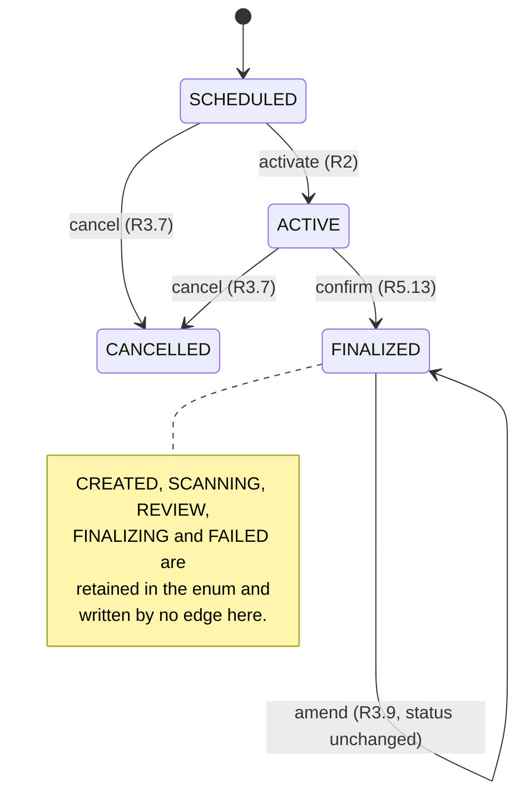
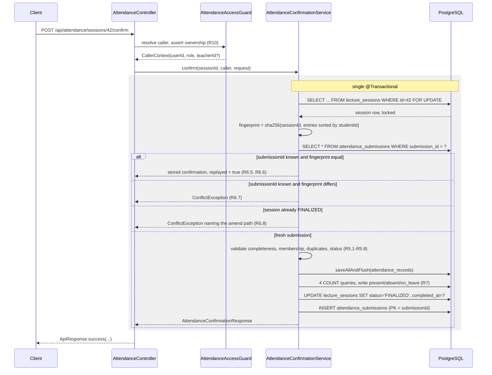
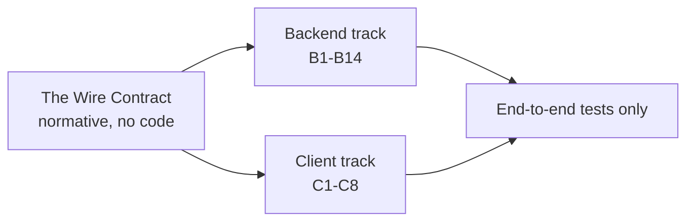

# Design Document

## Overview

This design adds teacher-driven manual attendance marking on top of the live V5–V8 schema. Nothing in the existing persistence layer is redesigned: `lecture_sessions`, `attendance_records`, `enrollments` and `leave_requests` stay exactly as they are, and the eleven existing Spring Data repositories are reused. The feature adds one migration (V9) for two new append-only stores, one `Clock` bean, one controller, one service facade with four collaborators, four shared wire payloads, one Ktor repository implementation and one Compose screen.

The design has two jobs beyond describing the code.

The first is to settle the four decisions the requirements deferred: where the Submission_Record and Attendance_Audit_Entry stores live, what the injected time source is, which mechanism guarantees the concurrency rule in criterion 6.11, and whether the six operations sit on one controller or two. Each is settled in [Settled Decisions](#settled-decisions) with the reasoning and the test that holds the decision in place.

The second is to make the implementation safe to execute by several agents at once. This session already produced two real wire-contract drift bugs — `semesterId` typed `Long` in shared DTOs while the database column is `uuid`, and a test written against `mockito-kotlin` when the project declares `mockk` — and reading the code for this design surfaced a third: the backend emits `error.details` as a JSON **object** while the shared `ErrorResponse` declares it as a JSON **array**, which collides with criterion 5.2's requirement to return omitted student identifiers in the details. Drift is therefore treated as the primary design risk. [The Wire Contract](#the-wire-contract) states every field, type, nullability and example **once**, normatively, and [Parallel Implementation Plan](#parallel-implementation-plan) names a single owner for every file that more than one unit might touch.

### What this design does not change

- `DashboardService` is not modified. Criterion 8.1 is already satisfied: the percentage derives from `AttendanceRecordRepository.countAttended` / `countCountable`, never from a Lecture_Session counter. Requirement 8 is enforced here by constraining what the Attendance_Service is permitted to write, not by changing the dashboard.
- `GlobalExceptionHandler` is not modified. Every error path maps onto an exception type it already handles.
- `JacksonConfig` is not modified. It already emits `LocalDate`/`LocalDateTime`/`LocalTime` as ISO-8601 strings.
- The `AttendanceMethod` enum keeps `CAMERA`/`MANUAL`/`HYBRID` and `SessionStatus` keeps all nine values, so the camera flow lands later without a schema or enum change.
- The existing `ConfirmAttendanceRequest` in `shared/data/api/request/AttendanceRequests.kt` is left alone for the camera flow. The manual flow gets its own request type, so there is no shape clash on a shared name.

---

## Architecture

### Layering

The project's `controller → service → repository` layering is preserved. The one addition is that the glossary's single **Attendance_Service** is realised as a thin public facade over four package-internal collaborators. The controller sees only the facade, so criterion 10.12 ("the controller issues no repository query beyond resolving the caller") and the glossary's "called only by the Attendance_Controller" both hold. The split exists so that four agents can write four files concurrently instead of serialising on one 600-line service. This is a deliberate reading of the glossary and is called out here so a reviewer does not mistake it for drift.

```mermaid
graph TD
    subgraph Android
        Screen[MarkAttendanceScreen<br/>Compose] --> VM[MarkAttendanceViewModel<br/>Hilt, StateFlow]
    end

    subgraph Shared KMP
        VM --> IRepo[AttendanceRepository<br/>commonMain interface]
        IRepo -.implemented by.-> HRepo[HttpAttendanceRepository<br/>androidMain]
        HRepo --> Api[ApiClient<br/>Ktor 2.3.5]
    end

    Api -->|HTTPS /api/attendance/...| Ctl

    subgraph Backend
        Ctl[AttendanceController<br/>@RequestMapping /attendance] --> Guard[AttendanceAccessGuard]
        Ctl --> Facade[AttendanceService<br/>facade]
        Facade --> Roster[AttendanceRosterService<br/>R1, R4]
        Facade --> Life[SessionLifecycleService<br/>R2, R3, R7.7]
        Facade --> Confirm[AttendanceConfirmationService<br/>R5, R6]
        Facade --> Amend[AttendanceAmendmentService<br/>R9]
        Confirm --> Counters[SessionCounterRecalculator<br/>R7]
        Amend --> Counters
        Confirm --> Fp[RequestFingerprint<br/>R6.3]
        Life --> Trans[SessionTransitions<br/>R3.10]
        Confirm --> Trans
    end

    subgraph Repositories
        Roster --> ER[EnrollmentRepository]
        Roster --> LRR[LeaveRequestRepository]
        Roster --> ARR[AttendanceRecordRepository]
        Life --> LSR[LectureSessionRepository]
        Confirm --> LSR
        Confirm --> ARR
        Confirm --> SR[AttendanceSubmissionRepository<br/>NEW]
        Amend --> AER[AttendanceAuditEntryRepository<br/>NEW]
        Counters --> ARR
        Guard --> UR[UserRepository / StudentRepository / TeacherRepository]
    end

    Clock[Clock bean<br/>R2.10] --> Roster
    Clock --> Life
    Clock --> Confirm
    Clock --> Amend
```

### Legal session transitions

The four legal transitions of requirement 3 are declared once, in `SessionTransitions`, as the single source criterion 3.10 asks for. The five camera-flow statuses are reachable by no edge in this map.



### The confirmation transaction

Everything after the pessimistic lock runs inside one transaction. The lock is the first statement, which is what makes criterion 6.11 deterministic rather than a race on the unique index.



---

## Settled Decisions

### Decision A — The two new stores land as migration V9

PostgreSQL is at **V8 applied**, so the next version number is **V9**. One migration, `V9__create_attendance_marking_tables.sql`, creates both tables. One migration rather than two because the two tables arrive together with this feature and splitting them buys nothing.

**Column, index and FK definitions are in [Data Models](#data-models).** The decisions that needed making:

| Question | Decision | Why |
|---|---|---|
| How is the stored Attendance_Confirmation held? | `confirmation_json TEXT NOT NULL`, holding the serialized response | `jsonb` would need `@JdbcTypeCode(SqlTypes.JSON)` and behaves differently on H2, where repository tests run with `ddl-auto: create-drop`. `TEXT` maps identically on both engines, which matters because dev runs `ddl-auto: validate`. Nothing queries inside the payload. |
| Does the audit table denormalise the session and student? | Yes — `lecture_session_id` and `student_id` columns | Criterion 9.16 queries audit history by session and 9.14 derives `isCorrected` per record. Denormalising makes both a single index hit and keeps the JPQL free of entity joins, which were already flagged as a bootstrap-validation hazard in this codebase. |
| Do the new tables get `updated_at` and the update trigger? | No | Both are append-only. `attendance_submissions` rows are never modified; `attendance_audit_entries` rows are never modified (criterion 9.15). An `updated_at` column would be dead weight that implies mutability. |
| Is criterion 9.13 enforced in the database? | Yes — `CHECK (previous_status <> new_status)` | The requirement says a no-op amendment writes no audit entry. A check constraint makes a service bug impossible to persist rather than merely unlikely. |
| FK delete behaviour on the audit table? | `ON DELETE CASCADE`, matching V7's convention | `RESTRICT` would be stronger for audit integrity but would make deleting a lecture session fail, changing the behaviour of the existing `lecture_sessions → attendance_records` cascade. Criterion 9.15 constrains the Attendance_Service, and the service exposes no delete or update path for audit entries. **Trade-off stated plainly: a direct `DELETE FROM lecture_sessions` outside the service would take audit history with it.** No code path in this spec does that. |

**Retention policy.**

| Store | Retention | Mechanism |
|---|---|---|
| `attendance_submissions` | 90 days from `created_at` | Idempotency only needs to span a client's retry window, which is minutes. 90 days is for support and debugging. Purge is a documented SQL statement in the migration's trailing comment, run by an operator. **No scheduled job is added** — a `@Scheduled` purge is untestable without extra clock plumbing and is scope creep against requirement 6. |
| `attendance_audit_entries` | Indefinite — never purged | Criterion 9.15 requires every entry to be retained with no deletion and no overwrite. The migration comment records that this table is deliberately unbounded. |

### Decision B — The time source is a `java.time.Clock` bean

Criterion 2.10 requires a single injected time source. It is `java.time.Clock`, not a narrower interface.

```kotlin
// backend/src/main/kotlin/com/afora/backend/common/config/TimeConfig.kt
@Configuration
class TimeConfig {
    /** The single time source of requirement 2.10. Tests override with Clock.fixed. */
    @Bean
    fun clock(): Clock = Clock.systemDefaultZone()
}
```

Every one of the four collaborators takes `private val clock: Clock` and derives both kinds of value from it:

- "current server date" (criteria 2.1, 2.4, 2.5, 2.6, 2.7, 4.1) → `LocalDate.now(clock)`
- "current server timestamp" (criteria 2.2, 5.12, 5.14, 7.8, 9.1, 9.9) → `LocalDateTime.now(clock)`

**Why `Clock` over a custom `TimeSource` interface:**

- It is JDK-standard, so no new abstraction has to be learned, documented or kept in sync.
- `Clock.fixed(instant, zone)` gives tests total control with **no mocking at all**. A custom interface needs a hand-written fake, and the fake needs its own test. Fewer moving parts is the whole point.
- One bean genuinely satisfies "single time source" because both `LocalDate` and `LocalDateTime` derive from it. A two-method interface would let the two methods drift apart.
- A custom interface hides the zone. `Clock` carries it explicitly, which matters here (see below).

**How tests control it.** Three levels, no mocking of time anywhere:

| Test kind | Mechanism |
|---|---|
| Service unit test (MockK for repositories) | Construct the service directly: `AttendanceRosterService(repos..., Clock.fixed(Instant.parse("2026-02-14T09:15:00Z"), ZoneOffset.UTC))` |
| Property test over the clock | Generate the instant: `Arb.instant(...)` → `Clock.fixed(generated, ZoneOffset.UTC)`. This is why criteria 2.2, 5.12 and 5.14 become properties rather than examples. |
| `@SpringBootTest` | A `@TestConfiguration` contributing a `@Primary` fixed `Clock` bean |

**Zone caveat, stated because it is a real deployment constraint.** All the relevant columns are `TIMESTAMP`/`DATE` without time zone, so "current server date" is whatever the JVM's default zone says. `Clock.systemDefaultZone()` makes that explicit rather than hidden. The deployment must pin the JVM `TZ` to the institution's zone, otherwise the 14-day activation window and the 168-hour amendment window shift by up to a day at the boundary. This is recorded here rather than silently assumed.

### Decision C — Criterion 6.11 rests on a pessimistic row lock over the Lecture_Session

Criterion 6.11: two confirmation requests bearing **different** `submissionId` values for the same session, executing concurrently, must persist the entries of exactly one.

**Why the other two candidates do not carry the guarantee.**

The Submission_Record primary key cannot help at all. The two `submissionId` values differ by hypothesis, so both inserts succeed. The primary key answers a different question (criterion 6.12, duplicate inserts of the *same* identifier).

The `attendance_records` unique constraint does produce a correct final state, but by accident rather than by design. Under PostgreSQL's default READ COMMITTED, both transactions read `status = ACTIVE`, both pass the status check, both validate their payloads, both build a full record set, and then one loses on the unique index at flush. The outcome satisfies 6.11 but has three defects: the loser's failure arrives as a `DataIntegrityViolationException` mid-flush, so the client learns "conflict" with no useful explanation; both transactions have already recomputed counters and set `status = FINALIZED`, which is a lost update on the session row; and the behaviour depends on flush ordering, so the test for it would be timing-sensitive.

**The chosen mechanism.** A `PESSIMISTIC_WRITE` lock on the Lecture_Session row, acquired as the first statement of the confirm transaction and of the amend transaction. Added to the existing repository — reuse, not replacement:

```kotlin
// added to academic/repository/LectureSessionRepository.kt
@Lock(LockModeType.PESSIMISTIC_WRITE)
@Query("SELECT ls FROM LectureSession ls WHERE ls.id = :id")
fun findByIdForUpdate(@Param("id") id: Long): LectureSession?
```

An explicit `@Query` is required: `@Lock` on a derived `findById` does not reliably produce `FOR UPDATE`.

This serialises the entire confirm critical section on the session row. The loser then blocks, acquires the lock after the winner commits, **reads `status = FINALIZED`**, and takes the clean criterion 6.8 path — HTTP 409 with a message naming the amendment path. That is a far better answer than a constraint-violation 409, and it is deterministic.

**The other two mechanisms stay in place as backstops, and both are still required:**

| Layer | Guards | Requirement |
|---|---|---|
| `PESSIMISTIC_WRITE` on the session row | Concurrent confirms with different `submissionId` (the 6.11 case) | 6.11 |
| `attendance_submissions` primary key on `submission_id` | A duplicate insert of the same identifier, at the database level | 6.12 |
| `attendance_records` unique `(lecture_session_id, student_id)` | Any path that slips past both of the above | 6.10 |

Criterion 6.10 needs explicit handling: `DataIntegrityViolationException` is **not** one of the types `GlobalExceptionHandler` maps, so it would reach the generic handler and return HTTP 500. `AttendanceConfirmationService` catches it and rethrows `ConflictException`. See [Error Handling](#error-handling).

**How criterion 6.11 is tested.** This one cannot be a property test and cannot run under `@DataJpaTest`, because `@DataJpaTest` wraps each test in a single transaction that is rolled back — two transactions can never race inside it. It needs a real concurrent integration test:

`backend/src/test/kotlin/com/afora/backend/attendance/integration/ConfirmationConcurrencyTest.kt`, a `@SpringBootTest(webEnvironment = NONE)` on H2, with:

1. One ACTIVE session with a known ACTIVE enrollment count.
2. An `ExecutorService` of two threads, each calling `attendanceService.confirm(...)` with a **different** `submissionId` and the same complete entry list.
3. A `CountDownLatch(1)` released after both threads have started, so they contend.
4. Assertions: exactly one call returns a confirmation and the other throws `ConflictException`; `attendance_records` holds exactly `activeEnrollmentCount` rows for the session; `attendance_submissions` holds exactly one row for the session; `present + absent + on_leave == record count`.

**Caveat recorded honestly:** H2's `SELECT ... FOR UPDATE` locking is not PostgreSQL MVCC. The test proves the lock is acquired and that the outcome is single-winner, which is the behavioural claim. It does not prove PostgreSQL-specific isolation behaviour. The invariant assertions in step 4 are the part that would still fail on either engine if the design were wrong, which is why they carry the weight rather than the exception type alone.

### Decision D — One controller, with the authorization pre-flight extracted

**One controller:** `AttendanceController`, mapped `@RequestMapping("/attendance")`. With `server.servlet.context-path: /api` the deployed routes resolve under `/api/attendance`, satisfying criterion 10.9.

Reasoning:

- All six operations share one authorization pre-flight: resolve the caller, load the session, walk to its class section, compare teacher identifiers. Splitting the controller either duplicates that helper or extracts it — and once it is extracted, the split buys nothing.
- All six are keyed on one aggregate root, the Lecture_Session, so the routes form one coherent resource tree.
- `DashboardController` already demonstrates exactly this shape (one controller, private authorization helpers, `ApiResponse` wrapping). Matching it keeps the codebase uniform.
- Six endpoints is not a large controller.

The one real argument for two controllers is that two agents could then edit two files concurrently. That concern is answered differently and better: the pre-flight moves into its own component, `AttendanceAccessGuard`, which is a separate file with a separate owner. `AttendanceController` itself is then a thin file — six methods, each resolving the caller through the guard and delegating to the facade — written by one agent at the end of the backend track.

| Method | Path (deployed) | Operation | Requirement |
|---|---|---|---|
| GET | `/api/attendance/sessions/{sessionId}/roster` | Read the roster | 1, 4 |
| POST | `/api/attendance/sessions/{sessionId}/activate` | SCHEDULED → ACTIVE | 2 |
| POST | `/api/attendance/sessions/{sessionId}/confirm` | ACTIVE → FINALIZED | 5, 6, 7 |
| POST | `/api/attendance/sessions/{sessionId}/cancel` | → CANCELLED | 3.7 |
| POST | `/api/attendance/sessions/{sessionId}/amend` | Amend a FINALIZED session | 9 |
| GET | `/api/attendance/sessions/{sessionId}/audit-history` | Read the audit trail | 9.16 |

`POST` is used for `activate` and `cancel` rather than `PATCH`: they are named state transitions on a sub-resource, not partial updates of a representation, and the verb-path form reads unambiguously.

**The session identifier appears only in the path, never in a request body.** This removes an entire class of bug — a payload whose body `sessionId` disagrees with its path `sessionId` — and it means the fingerprint of criterion 6.3 has exactly one source for the session identifier.

---

## Components and Interfaces

### Backend

#### `AttendanceAccessGuard` — `attendance/security/AttendanceAccessGuard.kt`

Owns requirement 10 entirely. The controller calls it and nothing else before delegating.

```kotlin
@Component
class AttendanceAccessGuard(
    private val userRepository: UserRepository,
    private val studentRepository: StudentRepository,
    private val teacherRepository: TeacherRepository,
    private val lectureSessionRepository: LectureSessionRepository
) {
    /** R10.1, R10.2. Note `.orElseThrow {}` — NOT elvis; findByFirebaseUid returns Optional. */
    fun requireCaller(firebaseUid: String?): CallerContext

    /** R10.3-R10.7. Loads the session, walks to its section, compares teacher ids. */
    fun requireSessionAccess(caller: CallerContext, sessionId: Long): LectureSession
}

data class CallerContext(
    val userId: Long,
    val role: UserRole,
    /** The caller's own teacher.id; null for ADMIN. */
    val teacherId: Long?
)
```

Rules, each traceable:

- `firebaseUid == null` → `UnauthorizedException` (10.1).
- `userRepository.findByFirebaseUid(uid).orElseThrow { UnauthorizedException(...) }` → 401 for an unknown uid (10.2). **Elvis (`?:`) does not compile against `Optional<User>` and silently misbehaves if forced; this was a real bug fixed earlier in this project.**
- `role == ADMIN` → `teacherId = null`, no further check (10.3).
- `role == STUDENT` → `ForbiddenException` (10.4).
- `role == TEACHER` → `teacherRepository.findByUserId(userId).orElseThrow { ForbiddenException(...) }` (10.5, 10.6), then `session.classSection.teacher.id == caller.teacherId` or `ForbiddenException` (10.7).
- Session not found → `ResourceNotFoundException` (1.8). Ordering matters: the 401 check precedes the 404, so an unauthenticated request to a nonexistent session returns 401, not 404.

#### `SessionTransitions` — `attendance/service/SessionTransitions.kt`

The single declared mapping criterion 3.10 asks for. A pure object with no dependencies, which is why it can be written and property-tested in the first wave.

```kotlin
object SessionTransitions {
    /** The only four legal transitions in the Manual_Marking_Flow (R3.1). */
    val LEGAL: Set<Pair<SessionStatus, SessionStatus>> = setOf(
        SessionStatus.SCHEDULED to SessionStatus.ACTIVE,
        SessionStatus.SCHEDULED to SessionStatus.CANCELLED,
        SessionStatus.ACTIVE    to SessionStatus.CANCELLED,
        SessionStatus.ACTIVE    to SessionStatus.FINALIZED
    )

    fun isLegal(from: SessionStatus, to: SessionStatus): Boolean = (from to to) in LEGAL

    /** Throws ConflictException for any pair outside LEGAL (R3.2). */
    fun require(from: SessionStatus, to: SessionStatus)
}
```

An amendment is deliberately **not** a transition: it leaves the status at FINALIZED (3.9), and `FINALIZED to FINALIZED` is absent from `LEGAL`, so the amendment path never consults this map.

#### `RequestFingerprint` — `attendance/service/RequestFingerprint.kt`

Pure function, no dependencies. Criterion 6.3.

```kotlin
object RequestFingerprint {
    /**
     * SHA-256 hex over the session id and the entries sorted by student id ascending.
     * Canonical form, one line per entry:
     *   "<sessionId>\n<studentId>:<status>:<notes ?: "">\n..."
     * Sorting is what makes the digest independent of submission order (R6.3).
     */
    fun of(sessionId: Long, entries: List<SubmittedAttendanceEntry>): String
}
```

The canonical form includes `notes` because `notes` is persisted; a replay that changes a note is a different submission and must conflict under criterion 6.7. It does **not** include `markUnspecifiedAsAbsent`, because that flag changes which students are *in* the effective entry set, and the effective set is what the digest covers — the flag's effect is therefore already captured. Returned as lowercase hex, 64 characters, matching the `CHAR(64)` column.

#### `SessionCounterRecalculator` — `attendance/service/SessionCounterRecalculator.kt`

Owns requirement 7. Called from both the confirm and the amend transaction.

```kotlin
@Component
class SessionCounterRecalculator(
    private val attendanceRecordRepository: AttendanceRecordRepository,
    private val lectureSessionRepository: LectureSessionRepository,
    private val clock: Clock
) {
    /**
     * Recomputes all three counters by COUNTING stored records (R7.5), never by
     * incrementing, and writes updated_at (R7.8). Must be called after the
     * records have been flushed.
     */
    fun recompute(sessionId: Long): SessionCounters
}

data class SessionCounters(val present: Int, val absent: Int, val onLeave: Int, val total: Int)
```

Three decisions worth stating:

**Derived count queries, not JPQL.** The four counts are added to `AttendanceRecordRepository` as Spring Data derived methods, so there is no JPQL and therefore no exposure to the fully-qualified-enum-literal hazard that has already bitten this codebase. Statuses travel as bound parameters.

```kotlin
// added to attendance/repository/AttendanceRecordRepository.kt
fun countByLectureSessionIdAndStatusIn(lectureSessionId: Long, statuses: Collection<AttendanceStatus>): Int
fun countByLectureSessionId(lectureSessionId: Long): Int
fun findByLectureSessionIdAndStudentIdIn(lectureSessionId: Long, studentIds: Collection<Long>): List<AttendanceRecord>
```

`countBy…` returns 0 over an empty set, which gives criterion 7.9 for free with no special case.

**Explicit flush before counting.** The caller uses `attendanceRecordRepository.saveAllAndFlush(records)` before `recompute`. Hibernate's `FlushModeType.AUTO` would usually flush before the count queries anyway, but relying on that is exactly the kind of implicit behaviour that produces an intermittent off-by-N counter. The flush is explicit.

**A partition guard that fails loudly.** `recompute` ends with

```kotlin
check(present + absent + onLeave == total) {
    "counter partition broken for session $sessionId: $present+$absent+$onLeave != $total"
}
```

Criterion 7.6 holds by construction because `{PRESENT, LATE}`, `{ABSENT}` and `{ON_LEAVE, EXCUSED}` partition the five `AttendanceStatus` values. The `check` is the tripwire that fires if a sixth value is ever added without updating the partition. It surfaces as HTTP 500, which is correct: an unpartitioned enum is a programming error, not a client error.

Note on `on_leave_count`: criterion 7.4 brings EXCUSED into this counter, which differs from the V7 seed's `COUNT(*) FILTER (WHERE status = 'ON_LEAVE')`. The V7 seed inserts no EXCUSED row, so no seeded value changes — verified by reading the seed.

#### `AttendanceRosterService` — `attendance/service/AttendanceRosterService.kt`

Owns requirements 1 and 4. Read-only; `@Transactional(readOnly = true)`.

```kotlin
@Service
@Transactional(readOnly = true)
class AttendanceRosterService(
    private val enrollmentRepository: EnrollmentRepository,
    private val attendanceRecordRepository: AttendanceRecordRepository,
    private val leaveRequestRepository: LeaveRequestRepository,
    private val auditEntryRepository: AttendanceAuditEntryRepository,
    private val clock: Clock
) {
    fun roster(session: LectureSession): RosterResponse
}
```

Flow:

1. `enrollmentRepository.findActiveRosterByClassSectionId(sectionId)` — a new fetch-joining query so student and user load in one round trip rather than N+1.
2. `attendanceRecordRepository.findByLectureSessionId(sessionId)` → index by `studentId`, giving `storedStatus` or null (1.4, 1.5).
3. `leaveRequestRepository.findApprovedCovering(studentIds, sessionDate, sectionId)` — new query, see below.
4. Suggested status: ON_LEAVE where covered, otherwise PRESENT (4.1, 4.2).
5. `isCorrected` per entry from `auditEntryRepository.findStatusChangedRecordIds(sessionId)` (9.14, 11.9).
6. Sort by `rollNumber` ascending (1.6) and project the session header (1.7).

The leave query carries the whole covering predicate of criterion 4.1, including the nullable section qualifier:

```kotlin
// added to attendance/repository/LeaveRequestRepository.kt
@Query("""
    SELECT lr FROM LeaveRequest lr
    WHERE lr.student.id IN :studentIds
      AND lr.status = com.afora.backend.attendance.entity.LeaveStatus.APPROVED
      AND lr.fromDate <= :sessionDate
      AND lr.toDate   >= :sessionDate
      AND (lr.classSection IS NULL OR lr.classSection.id = :classSectionId)
""")
fun findApprovedCovering(
    @Param("studentIds") studentIds: Collection<Long>,
    @Param("sessionDate") sessionDate: LocalDate,
    @Param("classSectionId") classSectionId: Long
): List<LeaveRequest>
```

The enum literal is fully qualified, matching the established pattern in `countPendingForTeacher`. Both date comparisons are inclusive, which is what "inclusively span" means in 4.1. Where several APPROVED requests cover the same date, the one with the lowest `id` supplies `leaveRequestId` and `leaveReason` — a stated tie-break, so the response is deterministic.

Criterion 4.7 ("no record derives from a suggestion alone") is structural: this service is `readOnly = true` and calls no save method.

#### `SessionLifecycleService` — `attendance/service/SessionLifecycleService.kt`

Owns requirements 2, 3.7 and 7.7.

```kotlin
@Service
class SessionLifecycleService(
    private val lectureSessionRepository: LectureSessionRepository,
    private val enrollmentRepository: EnrollmentRepository,
    private val clock: Clock
) {
    @Transactional fun activate(session: LectureSession, caller: CallerContext): SessionSummary
    @Transactional fun cancel(session: LectureSession, caller: CallerContext): SessionSummary
}
```

Activation, in order:

1. If `status == ACTIVE`, return the session untouched — `startedAt`, `attendanceMethod` and `totalStudents` all unchanged (2.8). This check comes **before** the window checks, so re-activating a session that has since drifted past the 14-day window still succeeds as a no-op rather than returning 403.
2. `SessionTransitions.require(status, ACTIVE)` (3.1, 3.2).
3. `sessionDate > LocalDate.now(clock)` → `BadRequestException` (2.4).
4. For `role == TEACHER`, `DAYS.between(sessionDate, today) > 14` → `ForbiddenException` (2.5, 2.6). ADMIN skips this (2.7).
5. Write `status = ACTIVE`, `startedAt = LocalDateTime.now(clock)` (2.2), `attendanceMethod = MANUAL` (2.3), `totalStudents = enrollmentRepository.countByClassSectionIdAndStatus(sectionId, ACTIVE)` (7.7), `updatedAt = now`.

The 400-before-403 ordering is deliberate and testable: a future-dated session is a malformed request regardless of who asks, so it outranks the role check.

Cancellation: `SessionTransitions.require(status, CANCELLED)`, then write `status = CANCELLED` and `updatedAt`. **It touches no attendance record and no counter** — that is how criteria 3.8 and 8.6 are satisfied, by writing less rather than by compensating.

#### `AttendanceConfirmationService` — `attendance/service/AttendanceConfirmationService.kt`

Owns requirements 5, 6 and the confirm half of 7. Single `@Transactional` method, ordered exactly as the sequence diagram shows.

```kotlin
@Service
class AttendanceConfirmationService(
    private val lectureSessionRepository: LectureSessionRepository,
    private val attendanceRecordRepository: AttendanceRecordRepository,
    private val enrollmentRepository: EnrollmentRepository,
    private val studentRepository: StudentRepository,
    private val teacherRepository: TeacherRepository,
    private val submissionRepository: AttendanceSubmissionRepository,
    private val counters: SessionCounterRecalculator,
    private val objectMapper: ObjectMapper,
    private val clock: Clock
) {
    @Transactional
    fun confirm(
        sessionId: Long,
        caller: CallerContext,
        request: ConfirmAttendanceRequestDto
    ): AttendanceConfirmationResponse
}
```

Step order, because several steps must precede others to produce the right status code:

1. `findByIdForUpdate(sessionId)` — the lock (Decision C).
2. Parse `submissionId` as a UUID → `BadRequestException` on failure (6.1, 6.2).
3. Parse each entry's `status` string into `AttendanceStatus` → `BadRequestException` naming the offending value (5.8). See [Error Handling](#error-handling) for why the DTO field is a `String`.
4. Reject duplicate `studentId` values (5.7).
5. Compute the fingerprint (6.3).
6. Look up the Submission_Record. Same fingerprint → return the stored confirmation with `replayed = true`, writing nothing (6.5, 6.6). Different fingerprint → `ConflictException` (6.7).
7. `status != ACTIVE` → `ConflictException`; when the status is FINALIZED the message names the amendment path (2.9, 6.8).
8. Load the ACTIVE enrollment set. Entries for students outside it → `BadRequestException` with `unknownStudentIds` (5.6, 8.2). Omissions: `markUnspecifiedAsAbsent == false` → `BadRequestException` with `omittedStudentIds` (5.1, 5.2); `true` → synthesise ABSENT entries and collect them into `defaultedStudentIds` (5.4, 5.5).
9. Build records: `method = MANUAL` (5.9), `confidenceScore = null` (5.10), `markedAt = LocalDateTime.now(clock)` (5.12), `markedByTeacher` = the caller's `Teacher` for TEACHER and **null for ADMIN** (5.11, 5.17).
10. `saveAllAndFlush`, then `counters.recompute(sessionId)` (7.1).
11. `status = FINALIZED` (5.13), `completedAt = LocalDateTime.now(clock)` (5.14).
12. Insert the Submission_Record with the serialized response (6.4, 6.9, 6.12).

Steps 2–7 precede step 8 so that a replay of a valid submission never re-runs validation, and so that a stale client retrying against a finalized session gets the amendment-path message rather than a completeness error.

Criterion 5.17 is worth restating because it is easy to get backwards: when an ADMIN confirms, `marked_by_teacher_id` is **null**, and the ADMIN's identity is recorded only in audit entries. No attendance record ever attributes a marking to a teacher who did not perform it.

#### `AttendanceAmendmentService` — `attendance/service/AttendanceAmendmentService.kt`

Owns requirement 9 and the amend half of 7.

```kotlin
@Service
class AttendanceAmendmentService(
    private val lectureSessionRepository: LectureSessionRepository,
    private val attendanceRecordRepository: AttendanceRecordRepository,
    private val auditEntryRepository: AttendanceAuditEntryRepository,
    private val counters: SessionCounterRecalculator,
    private val clock: Clock
) {
    @Transactional fun amend(sessionId: Long, caller: CallerContext, request: AmendAttendanceRequestDto): AmendmentResultResponse
    @Transactional(readOnly = true) fun auditHistory(sessionId: Long): AuditHistoryResponse
}
```

Order:

1. `findByIdForUpdate(sessionId)` — same lock as confirm, so an amendment cannot interleave with a confirmation.
2. `status != FINALIZED` → `ConflictException` (9.12).
3. `request.reason.isBlank()` → `BadRequestException` (9.4, 9.5). Kotlin's `isBlank()` is Unicode-aware, which is what "whitespace" has to mean here.
4. Window: `role == ADMIN` → unlimited (9.3). `role == TEACHER` → `HOURS.between(completedAt, LocalDateTime.now(clock)) > 168` → `ForbiddenException` whose message names the administrator correction path (9.1, 9.2).
5. `findByLectureSessionIdAndStudentIdIn` for the named students; any student with no record → `ResourceNotFoundException` (9.11).
6. Per entry: if the submitted status equals the current status, skip it — no write, no audit entry (9.13), counted into `unchangedCount`. Otherwise write `status` and `updatedAt = LocalDateTime.now(clock)` (9.9), **preserving `markedAt` and `markedByTeacher`** (9.7, 9.8), and append one audit entry (9.6).
7. `saveAllAndFlush`, then `counters.recompute(sessionId)` (7.1).
8. Status stays FINALIZED (3.9) — the service simply does not write it.

`auditHistory` returns every entry for the session ordered by `changedAt` ascending (9.16) via `findByLectureSessionIdOrderByChangedAtAsc`. Criterion 9.15 is structural: the repository is used only through `save` and `findBy…`; no delete or update path exists.

One mapping detail that matters under `ddl-auto: validate`: `attendance_records` carries a PostgreSQL `BEFORE UPDATE` trigger that overwrites `updated_at`, while the H2 test schema has no such trigger. The service therefore writes `updatedAt` explicitly so the observable behaviour is identical on both engines, and criterion 9.9 holds in tests as well as in production.

#### `AttendanceService` — `attendance/service/AttendanceService.kt`

The facade. Roughly forty lines of delegation, no logic, no repositories. It is the only service type the controller references.

```kotlin
@Service
class AttendanceService(
    private val rosterService: AttendanceRosterService,
    private val lifecycleService: SessionLifecycleService,
    private val confirmationService: AttendanceConfirmationService,
    private val amendmentService: AttendanceAmendmentService
) {
    fun roster(session: LectureSession): RosterResponse
    fun activate(session: LectureSession, caller: CallerContext): SessionSummary
    fun cancel(session: LectureSession, caller: CallerContext): SessionSummary
    fun confirm(sessionId: Long, caller: CallerContext, request: ConfirmAttendanceRequestDto): AttendanceConfirmationResponse
    fun amend(sessionId: Long, caller: CallerContext, request: AmendAttendanceRequestDto): AmendmentResultResponse
    fun auditHistory(sessionId: Long): AuditHistoryResponse
}
```

#### `AttendanceController` — `attendance/controller/AttendanceController.kt`

Six methods, each the same three lines: resolve the caller, assert session access, delegate. Every body is wrapped in `ApiResponse.success(...)` (10.10).

```kotlin
@RestController
@RequestMapping("/attendance")
class AttendanceController(
    private val attendanceService: AttendanceService,
    private val accessGuard: AttendanceAccessGuard
) {
    @GetMapping("/sessions/{sessionId}/roster")
    fun roster(
        @AuthenticationPrincipal firebaseUid: String?,
        @PathVariable sessionId: Long
    ): ResponseEntity<ApiResponse<RosterResponse>> {
        val caller = accessGuard.requireCaller(firebaseUid)
        val session = accessGuard.requireSessionAccess(caller, sessionId)
        return ResponseEntity.ok(ApiResponse.success(attendanceService.roster(session)))
    }
    // activate, confirm, cancel, amend, auditHistory follow the identical shape
}
```

### Shared KMP

#### `AttendanceRepository` — `commonMain/data/repository/AttendanceRepository.kt`

Criterion 11.13 needs a roster member, an activation member, a confirmation member and an amendment member. Criteria 11.1–11.3 need the `semesterId` type corrections. Added and corrected:

```kotlin
interface AttendanceRepository {
    // --- Manual_Marking_Flow (R11.13) ---
    suspend fun getSessionRoster(lectureSessionId: Long): Result<RosterResponse>
    suspend fun activateSession(lectureSessionId: Long): Result<SessionSummary>
    suspend fun cancelSession(lectureSessionId: Long): Result<SessionSummary>
    suspend fun confirmManualAttendance(
        lectureSessionId: Long,
        request: ConfirmAttendanceRequest
    ): Result<AttendanceConfirmationResponse>
    suspend fun amendAttendance(
        lectureSessionId: Long,
        request: AmendAttendanceRequest
    ): Result<AmendmentResultResponse>
    suspend fun getAuditHistory(lectureSessionId: Long): Result<AuditHistoryResponse>

    // --- corrected signatures (R11.1, R11.2) ---
    suspend fun getStudentAttendance(studentId: Long, subjectId: Long, semesterId: String): Result<List<AttendanceRecord>>
    suspend fun getStudentAttendanceStats(studentId: Long, semesterId: String): Result<AttendanceStats>

    // --- camera-flow members, left as-is, unimplemented (R11.12) ---
    suspend fun startLectureSession(lectureId: Long): Result<LectureSessionWithStudents>
    suspend fun getEnrolledStudentsWithEmbeddings(lectureSessionId: Long): Result<List<StudentWithEmbedding>>
    suspend fun getAttendanceByLectureSession(lectureSessionId: Long): Result<List<AttendanceRecord>>
    suspend fun getLectureSession(lectureSessionId: Long): Result<LectureSession>
    suspend fun cancelLectureSession(lectureSessionId: Long): Result<Unit>
}
```

The existing `confirmAttendance(lectureSessionId, attendanceCandidates, submissionId)` camera member is **replaced** by `confirmManualAttendance`, which takes the whole request object. The reason is the fingerprint: criterion 6.3's digest covers the entries and the session id, so passing a single request object keeps the client unable to assemble a payload whose parts disagree. Nothing implements the old signature today, so this breaks no call site — verified by search.

`AttendanceStats.semesterId` becomes `String` (11.3), as does `StartLectureSessionRequest.semesterId` (11.4).

#### `HttpAttendanceRepository` — `androidMain/data/repository/HttpAttendanceRepository.kt`

Follows `HttpDashboardRepository` exactly: constructor-injected `ApiClient`, `when (val result: Result<ApiResponse<T>> = apiClient.get(...))`, unwrap `result.data.data`, return the project's `com.afora.shared.util.Result` with `AppError` on failure (11.11).

Three points specific to this repository:

**Full paths.** `ApiClient.buildUrl` prepends only the base URL, so every endpoint string is the complete path: `"/api/attendance/sessions/$lectureSessionId/roster"`. Not `"/attendance/..."`.

**Unimplemented members (11.12).** Each of the five camera-flow members returns, rather than throws:

```kotlin
override suspend fun startLectureSession(lectureId: Long): Result<LectureSessionWithStudents> =
    Result.Error(AppError.UnknownError("startLectureSession is not implemented in the manual marking flow"))
```

The message contains the member name, and the function body contains no `TODO()` and no `throw` — a thrown `NotImplementedError` inside a coroutine would surface as a crash rather than a handled error.

**Readable error messages.** `ApiClient.safeApiCall` does not deserialize non-2xx bodies; it passes `response.bodyAsText()` through as the `AppError.ApiError` message. Raw JSON in a Compose error banner is unacceptable, so this repository parses the backend error envelope with its own tolerant decoder:

```kotlin
@Serializable private data class BackendErrorEnvelope(val error: BackendErrorDetail? = null)
@Serializable private data class BackendErrorDetail(val message: String, val code: String? = null)

private val errorJson = Json { ignoreUnknownKeys = true; isLenient = true }

/** Extracts error.message from a backend envelope, falling back to the raw text. */
private fun humanise(raw: String): String =
    runCatching { errorJson.decodeFromString<BackendErrorEnvelope>(raw).error?.message }
        .getOrNull() ?: raw
```

`ignoreUnknownKeys = true` means this decoder skips `details` whatever shape it has, which is what sidesteps the object-versus-array mismatch described in [The Wire Contract](#the-wire-contract) without touching the shared `ErrorResponse` type that every other repository depends on.

#### `ApiClient` — one surgical change for criterion 13.9

Criterion 13.9 requires a status name outside the enum to produce `AppError.ApiError`. Today it cannot: `response.body<T>()` sits inside the outer `try`, so a `SerializationException` lands in the generic `catch` and becomes `AppError.NetworkError`. A malformed payload would be reported to the user as a connectivity problem.

The fix is five lines, inside the success branch so the real status code is still in scope:

```kotlin
HttpStatusCode.OK, HttpStatusCode.Created -> {
    try {
        Result.Success(response.body<T>())
    } catch (e: SerializationException) {
        Result.Error(AppError.ApiError(
            code = response.status.value,
            message = "Malformed response body: ${e.message}"
        ))
    }
}
```

**Blast radius, verified.** `ApiClient` is shared by six repositories, so this is a single-owner edit. The change is strictly narrowing: it only affects 2xx responses whose body fails to deserialize, which previously returned `NetworkError` and now return `ApiError`. `shared/src/commonTest` contains only `DateTimeUtilTest` and `ResultTest`, neither of which touches `ApiClient`; no existing test asserts `NetworkError` for a malformed body. The other five repositories get a strictly better error for the same failure.

### Android

#### `MarkAttendanceUiState` — `ui/attendance/MarkAttendanceUiState.kt`

```kotlin
sealed interface MarkAttendanceUiState {
    data object Loading : MarkAttendanceUiState
    data class Success(
        val header: SessionHeader,
        val rows: List<AttendanceRow>,
        val presentCount: Int,
        val absentCount: Int,
        val onLeaveCount: Int,
        val isSubmitting: Boolean = false,
        val confirmation: AttendanceConfirmationResponse? = null,
        val amendmentWindowOpen: Boolean = false,
        val amendmentReason: String = ""
    ) : MarkAttendanceUiState
    data class Error(val message: String, val rows: List<AttendanceRow>) : MarkAttendanceUiState
}

data class AttendanceRow(
    val studentId: Long,
    val rollNumber: String,
    val fullName: String,
    val selectedStatus: AttendanceStatus,
    val storedStatus: AttendanceStatus?,
    val suggestedStatus: AttendanceStatus,
    val leaveReason: String?,
    val isCorrected: Boolean
)
```

`Error` carries `rows` so criterion 12.14 — a failed confirmation retains every status the teacher selected — is guaranteed by the type rather than by remembering to copy state. The three counters are stored on `Success` and recomputed on every row edit, satisfying 12.7.

#### `MarkAttendanceViewModel` — `ui/attendance/MarkAttendanceViewModel.kt`

```kotlin
@HiltViewModel
class MarkAttendanceViewModel @Inject constructor(
    private val attendanceRepository: AttendanceRepository,
    savedStateHandle: SavedStateHandle
) : ViewModel() {
    private val _uiState = MutableStateFlow<MarkAttendanceUiState>(Loading)
    val uiState: StateFlow<MarkAttendanceUiState> = _uiState.asStateFlow()
    // ...
}
```

Hilt constructor injection (12.21), `StateFlow` of a sealed state (12.2).

Row initialisation (12.5): `selectedStatus = entry.storedStatus ?: entry.suggestedStatus`. One expression covers the stored branch, the suggested branch and the FINALIZED case of 12.16, where every stored status is non-null.

The submission-attempt rule (12.9, 12.10) is the part most easily got wrong, so it is stated as an explicit field rather than left to the call site:

```kotlin
/**
 * The submissionId of the current confirmation attempt. Generated once when the
 * teacher presses confirm (R12.9) and reused by every retry until the attempt is
 * acknowledged (R12.10). Cleared only on success or on an explicit edit after a
 * failure, which starts a new attempt.
 */
private var attemptSubmissionId: String? = null
```

`confirm()` uses `attemptSubmissionId ?: UUID.randomUUID().toString().also { attemptSubmissionId = it }`. Nulling it on success is what makes a later, genuinely new confirmation a new attempt; keeping it across failures is what makes a retry over a flaky classroom network idempotent at the server.

`amendmentWindowOpen` comes from the roster response — **the server computes it from the single `Clock`**, so the 168-hour rule is evaluated once, server-side. A client-side computation would be wrong whenever the device clock is skewed, and skew on classroom tablets is common. Criterion 12.17 is satisfied by `status == FINALIZED && amendmentWindowOpen`, both read off the payload.

#### `MarkAttendanceScreen` — `ui/attendance/MarkAttendanceScreen.kt`

Standard `collectAsStateWithLifecycle()` + `when (state)` over the three cases. Accessibility specifics, since they are requirements and not polish:

- Each status selector gets `contentDescription = "${row.fullName}, marked ${row.selectedStatus.name}"` (12.19).
- The confirm control is sized from a named constant so the value is assertable in a plain unit test without an emulator: `object MarkAttendanceDimens { val ConfirmMinTouchTarget = 48.dp }`, applied as `Modifier.defaultMinSize(ConfirmMinTouchTarget, ConfirmMinTouchTarget)` (12.20).
- The confirm control is disabled while `isSubmitting` (12.11).
- Rows whose `suggestedStatus == ON_LEAVE` show `leaveReason` as supporting text (12.15).
- The amendment sheet's submit control is enabled only while `amendmentReason.isNotBlank()` (12.18), duplicating the server rule deliberately so the teacher gets immediate feedback rather than a round trip.

---

## Data Models

### Migration V9

PostgreSQL is at **V8 applied**, so this file is `V9__create_attendance_marking_tables.sql`. Both tables are append-only: no `updated_at`, no `update_updated_at_column()` trigger.

```sql
-- Migration V9: Submission records and attendance audit trail
-- Supports idempotent confirmation (R6) and amendment auditing (R9).

-- ---------------------------------------------------------------------------
-- Submission_Record. Primary key is the client-generated submissionId, so a
-- duplicate insert fails at the database level (R6.12).
-- Retention: 90 days from created_at. Purged by an operator, not a job.
-- ---------------------------------------------------------------------------
CREATE TABLE attendance_submissions (
    submission_id       UUID PRIMARY KEY,
    lecture_session_id  BIGINT NOT NULL REFERENCES lecture_sessions(id) ON DELETE CASCADE,
    acting_user_id      BIGINT NOT NULL REFERENCES users(id) ON DELETE CASCADE,
    request_fingerprint CHAR(64) NOT NULL,
    confirmation_json   TEXT NOT NULL,
    created_at          TIMESTAMP NOT NULL DEFAULT CURRENT_TIMESTAMP
);

CREATE INDEX idx_attendance_submissions_session ON attendance_submissions(lecture_session_id);
CREATE INDEX idx_attendance_submissions_created ON attendance_submissions(created_at);

COMMENT ON TABLE attendance_submissions IS
    'Idempotency keys for attendance confirmation. Append-only. Retention 90 days: '
    'DELETE FROM attendance_submissions WHERE created_at < now() - interval ''90 days'';';
COMMENT ON COLUMN attendance_submissions.request_fingerprint IS
    'Lowercase SHA-256 hex over the session id and the entries sorted by student id';
COMMENT ON COLUMN attendance_submissions.confirmation_json IS
    'The stored AttendanceConfirmation, replayed verbatim on a matching retry. '
    'TEXT rather than JSONB so the mapping is identical on PostgreSQL and H2.';

-- ---------------------------------------------------------------------------
-- Attendance_Audit_Entry. Append-only and never purged (R9.15).
-- lecture_session_id and student_id are denormalised so the audit-history
-- query (R9.16) and the isCorrected derivation (R9.14) need no entity join.
-- ---------------------------------------------------------------------------
CREATE TABLE attendance_audit_entries (
    id                   BIGSERIAL PRIMARY KEY,
    attendance_record_id BIGINT NOT NULL REFERENCES attendance_records(id) ON DELETE CASCADE,
    lecture_session_id   BIGINT NOT NULL REFERENCES lecture_sessions(id) ON DELETE CASCADE,
    student_id           BIGINT NOT NULL REFERENCES students(id) ON DELETE CASCADE,
    previous_status      VARCHAR(20) NOT NULL
        CHECK (previous_status IN ('PRESENT','ABSENT','LATE','ON_LEAVE','EXCUSED')),
    new_status           VARCHAR(20) NOT NULL
        CHECK (new_status IN ('PRESENT','ABSENT','LATE','ON_LEAVE','EXCUSED')),
    changed_by_user_id   BIGINT NOT NULL REFERENCES users(id) ON DELETE CASCADE,
    reason               TEXT NOT NULL,
    changed_at           TIMESTAMP NOT NULL DEFAULT CURRENT_TIMESTAMP,
    -- R9.13: a no-op amendment must write no audit entry. Enforced here so a
    -- service bug cannot persist one.
    CONSTRAINT chk_audit_status_changed CHECK (previous_status <> new_status)
);

CREATE INDEX idx_audit_session_changed ON attendance_audit_entries(lecture_session_id, changed_at);
CREATE INDEX idx_audit_record          ON attendance_audit_entries(attendance_record_id);

COMMENT ON TABLE attendance_audit_entries IS
    'Append-only record of attendance amendments. Never updated, never deleted, '
    'never purged (R9.15). Growth is bounded by amendment volume, not by time.';
```

Both `VARCHAR(20)` status columns match the `attendance_records.status` column type and check-constraint style from V7, so `@Enumerated(EnumType.STRING)` maps cleanly under `ddl-auto: validate`.

### New entities

Both use scalar `Long` columns for their foreign keys rather than `@ManyToOne` associations. The reason is that neither entity is ever navigated as an object graph — they are written once and read as flat projections — and scalar columns keep `@DataJpaTest` setup to one constructor call with no lazy proxies. Hibernate's `validate` mode checks column presence and type, not association shape, so a scalar mapping over a foreign-key column is correct.

Following the project convention: Kotlin data classes, every constructor parameter defaulted, `@Column` on the backing field so Hibernate uses field access and the default naming strategy (`requestFingerprint` → `request_fingerprint`, as verified with `isActive` → `is_active`).

```kotlin
// attendance/entity/AttendanceSubmission.kt
@Entity
@Table(name = "attendance_submissions")
data class AttendanceSubmission(
    @Id
    @Column(name = "submission_id", nullable = false, updatable = false)
    val submissionId: UUID = UUID.randomUUID(),

    @Column(name = "lecture_session_id", nullable = false, updatable = false)
    val lectureSessionId: Long = 0,

    @Column(name = "acting_user_id", nullable = false, updatable = false)
    val actingUserId: Long = 0,

    @Column(name = "request_fingerprint", nullable = false, updatable = false, length = 64)
    val requestFingerprint: String = "",

    @Column(name = "confirmation_json", nullable = false, updatable = false, columnDefinition = "TEXT")
    val confirmationJson: String = "",

    @Column(name = "created_at", nullable = false, updatable = false)
    val createdAt: LocalDateTime = LocalDateTime.now()
)
```

No `@GeneratedValue`: the primary key is client-supplied, which is the whole point of criterion 6.12.

```kotlin
// attendance/entity/AttendanceAuditEntry.kt
@Entity
@Table(name = "attendance_audit_entries")
data class AttendanceAuditEntry(
    @Id @GeneratedValue(strategy = GenerationType.IDENTITY)
    val id: Long = 0,

    @Column(name = "attendance_record_id", nullable = false, updatable = false)
    val attendanceRecordId: Long = 0,

    @Column(name = "lecture_session_id", nullable = false, updatable = false)
    val lectureSessionId: Long = 0,

    @Column(name = "student_id", nullable = false, updatable = false)
    val studentId: Long = 0,

    @Enumerated(EnumType.STRING)
    @Column(name = "previous_status", nullable = false, updatable = false, length = 20)
    val previousStatus: AttendanceStatus = AttendanceStatus.ABSENT,

    @Enumerated(EnumType.STRING)
    @Column(name = "new_status", nullable = false, updatable = false, length = 20)
    val newStatus: AttendanceStatus = AttendanceStatus.PRESENT,

    @Column(name = "changed_by_user_id", nullable = false, updatable = false)
    val changedByUserId: Long = 0,

    @Column(nullable = false, updatable = false, columnDefinition = "TEXT")
    val reason: String = "",

    @Column(name = "changed_at", nullable = false, updatable = false)
    val changedAt: LocalDateTime = LocalDateTime.now()
)
```

`updatable = false` on every column is the JPA-level expression of criterion 9.15: Hibernate will not emit an `UPDATE` for these entities even if a caller tries.

### New repositories

```kotlin
// attendance/repository/AttendanceSubmissionRepository.kt
@Repository
interface AttendanceSubmissionRepository : JpaRepository<AttendanceSubmission, UUID> {
    fun findByLectureSessionId(lectureSessionId: Long): List<AttendanceSubmission>
}
```

Lookup by `submissionId` is `findById`, inherited.

```kotlin
// attendance/repository/AttendanceAuditEntryRepository.kt
@Repository
interface AttendanceAuditEntryRepository : JpaRepository<AttendanceAuditEntry, Long> {

    /** R9.16: every entry for a session, change timestamp ascending. */
    fun findByLectureSessionIdOrderByChangedAtAsc(lectureSessionId: Long): List<AttendanceAuditEntry>

    /**
     * R9.14: the records of this session that carry at least one status-changing
     * audit entry. The chk_audit_status_changed constraint guarantees every
     * stored entry changed the status, so a plain projection is sufficient.
     */
    @Query("""
        SELECT DISTINCT ae.attendanceRecordId FROM AttendanceAuditEntry ae
        WHERE ae.lectureSessionId = :sessionId
    """)
    fun findStatusChangedRecordIds(@Param("sessionId") sessionId: Long): List<Long>

    fun countByAttendanceRecordId(attendanceRecordId: Long): Int
}
```

### Changes to existing repositories

Additive only. No existing method is altered, so the 55 passing backend tests are unaffected.

| File | Added | Requirement |
|---|---|---|
| `academic/repository/LectureSessionRepository.kt` | `findByIdForUpdate` (`@Lock(PESSIMISTIC_WRITE)`) | 6.11 |
| `academic/repository/EnrollmentRepository.kt` | `findActiveRosterByClassSectionId` (fetch-joins student → user) | 1.1 |
| `attendance/repository/AttendanceRecordRepository.kt` | `countByLectureSessionIdAndStatusIn`, `countByLectureSessionId`, `findByLectureSessionIdAndStudentIdIn` | 7.2–7.4, 7.9, 9.5 |
| `attendance/repository/LeaveRequestRepository.kt` | `findApprovedCovering` | 4.1 |

---

## The Wire Contract

**This section is normative.** The backend DTOs in `attendance/dto/AttendanceDto.kt` and the shared `@Serializable` types in `shared/.../data/api/` implement these tables verbatim, field name for field name and type for type. An agent on either side implements against this section and nothing else. If an implementation disagrees with a table here, the implementation is wrong.

Two drift bugs already occurred in this project from not having this table: `semesterId` typed `Long` against a `uuid` column, and a test written against `mockito-kotlin` when the project declares `mockk`. A third was found while writing this design and is settled below.

### Why one type per payload, not a wire DTO plus a domain mirror

`HttpDashboardRepository` uses separate `…ApiResponse` wire types with `toDomain()` mappers. For the four new attendance payloads this design uses a **single** `@Serializable` type each, returned directly by the repository interface, for one reason: a domain mirror doubles the number of places a field name is written, which doubles the drift surface this section exists to eliminate. These payloads hold only primitives, enums and lists, with no platform types, so a mirror would buy no insulation. Precedent supports it — the existing `AttendanceRecord` and `LectureSession` domain models are already `@Serializable`. The existing `getStudentAttendance`, `getStudentAttendanceStats` and `startLectureSession` members keep their current domain types with only the `semesterId` type corrected.

### Scalar conventions

| Concept | JSON | Kotlin (shared) | Kotlin (backend DTO) | Database | Example |
|---|---|---|---|---|---|
| Entity identifier | number | `Long` | `Long` | `BIGINT` | `42` |
| Semester identifier | **string** | **`String`** | **`String`** | **`uuid`** | `"7f3a9c21-4b8e-4d1a-9c55-1e2b3c4d5e6f"` |
| Submission identifier | **string** | **`String`** | **`String`**, parsed to `UUID` in the service | `uuid` | `"a1b2c3d4-e5f6-4789-abcd-ef0123456789"` |
| Session date | string | `String` | `LocalDate` | `date` | `"2026-02-14"` |
| Time of day | string | `String` | `LocalTime` | `time` | `"09:15:00"` |
| Timestamp | string | `String` | `LocalDateTime` | `timestamp` | `"2026-02-14T09:15:00"` |
| Enum | string equal to the constant name | the typed enum | the typed enum (except request `status`, see below) | `VARCHAR(20)` | `"ON_LEAVE"` |
| Count | number | `Int` | `Int` | `INTEGER` | `27` |

Three conventions that have bitten projects before and are therefore spelled out:

**`semesterId` is a string, always.** The column is `uuid`. `JacksonConfig` has no `UUID` customisation, so Jackson serializes `java.util.UUID` to its text form, and the existing `LectureSessionResponse` already does `semesterId = semesterId.toString()`. A `Long` on either side is the bug this project already shipped once.

**Payload timestamps carry no zone and no `Z`.** The columns are `TIMESTAMP WITHOUT TIME ZONE` and `JacksonConfig` registers `LocalDateTimeSerializer(ISO_LOCAL_DATE_TIME)`, so the wire form is `"2026-02-14T09:15:00"`. A client parsing these with `Instant.parse` will throw. Parse with `LocalDateTime`, or keep them as display strings, which is what the shared types do.

**The envelope's own `timestamp` is different and does carry a `Z`.** `ApiResponse.timestamp` is a `java.time.Instant`, so it serializes as `"2026-02-14T09:15:00.123456Z"`. The shared `ApiResponse` does not declare the field at all; `ApiClient`'s `Json` has `ignoreUnknownKeys = true`, so it is dropped harmlessly. Do not "fix" this by adding the field with a `LocalDateTime`-shaped parser.

### Enums — names must match exactly on both sides

Criteria 13.5–13.7. The serialized name is the constant name; no `@SerialName` and no `@JsonProperty` anywhere.

| Enum | Values, in order | Notes |
|---|---|---|
| `AttendanceStatus` | `PRESENT`, `ABSENT`, `LATE`, `ON_LEAVE`, `EXCUSED` | The shared enum currently declares `PRESENT, ABSENT, ON_LEAVE, LATE` — **wrong order and missing `EXCUSED`**. Fixed per 11.5. Order is normative so the two `values()` arrays can be compared index by index in tests. |
| `SessionStatus` | `SCHEDULED`, `CREATED`, `ACTIVE`, `SCANNING`, `REVIEW`, `FINALIZING`, `FINALIZED`, `CANCELLED`, `FAILED` | Already identical on both sides. All nine retained (3.4). |
| `AttendanceMethod` | `CAMERA`, `MANUAL`, `HYBRID` | Already identical on both sides. |

`PRESENT` and `LATE` satisfy `countsAsAttended`; `ON_LEAVE` and `EXCUSED` satisfy `isNeutral`.

### `GET /api/attendance/sessions/{sessionId}/roster` → `RosterResponse`

| Field | Type | Nullable | Example | Requirement |
|---|---|---|---|---|
| `sessionId` | number | no | `42` | 1.7 |
| `classSectionId` | number | no | `7` | 1.7 |
| `subjectId` | number | no | `3` | 1.7 |
| `subjectCode` | string | no | `"CS101"` | 1.7 |
| `subjectName` | string | no | `"Introduction to Programming"` | 1.7 |
| `sessionDate` | string `YYYY-MM-DD` | no | `"2026-02-14"` | 1.7, 13.11 |
| `startTime` | string `HH:mm:ss` | no | `"09:15:00"` | 1.7 |
| `endTime` | string `HH:mm:ss` | no | `"10:15:00"` | 1.7 |
| `sessionStatus` | `SessionStatus` | no | `"ACTIVE"` | 1.7 |
| `attendanceMethod` | `AttendanceMethod` | **yes** | `"MANUAL"` | — |
| `totalStudents` | number | **yes** | `30` | 7.7 |
| `presentCount` | number | no | `0` | 7.2 |
| `absentCount` | number | no | `0` | 7.3 |
| `onLeaveCount` | number | no | `0` | 7.4 |
| `startedAt` | string timestamp | **yes** | `"2026-02-14T09:16:02"` | 2.2 |
| `completedAt` | string timestamp | **yes** | `null` | 5.14 |
| `amendmentWindowOpen` | boolean | no | `false` | 12.17 |
| `entries` | array of `RosterEntry` | no | `[…]` | 1.1 |

`totalStudents` is nullable because the column is nullable and stays null until activation. `amendmentWindowOpen` is computed server-side from the single `Clock`: `sessionStatus == FINALIZED && completedAt != null && HOURS.between(completedAt, now) <= 168`. The client never evaluates the 168-hour rule itself.

`RosterEntry`:

| Field | Type | Nullable | Example | Requirement |
|---|---|---|---|---|
| `studentId` | number | no | `101` | 1.3 |
| `rollNumber` | string | no | `"2024CS001"` | 1.3 |
| `fullName` | string | no | `"Asha Menon"` | 1.3 |
| `storedStatus` | `AttendanceStatus` | **yes** | `null` | 1.4, 1.5 |
| `suggestedStatus` | `AttendanceStatus` | no | `"ON_LEAVE"` | 1.3, 4.1, 4.2 |
| `attendanceRecordId` | number | **yes** | `null` | — |
| `leaveRequestId` | number | **yes** | `88` | 4.4 |
| `leaveReason` | string | **yes** | `"Medical appointment"` | 4.4, 12.15 |
| `isCorrected` | boolean | no | `false` | 9.14, 11.9 |

`storedStatus` is null exactly when no record exists (1.5). `entries` is `[]` for a section with no ACTIVE enrollments (1.9), never null. Entries are ordered by `rollNumber` ascending (1.6) and the client preserves that order.

### `POST .../activate`, `POST .../cancel` → `SessionSummary`

No request body for either. Response:

| Field | Type | Nullable | Example |
|---|---|---|---|
| `sessionId` | number | no | `42` |
| `sessionStatus` | `SessionStatus` | no | `"ACTIVE"` |
| `sessionDate` | string `YYYY-MM-DD` | no | `"2026-02-14"` |
| `startTime` | string `HH:mm:ss` | no | `"09:15:00"` |
| `endTime` | string `HH:mm:ss` | no | `"10:15:00"` |
| `attendanceMethod` | `AttendanceMethod` | **yes** | `"MANUAL"` |
| `totalStudents` | number | **yes** | `30` |
| `presentCount` | number | no | `0` |
| `absentCount` | number | no | `0` |
| `onLeaveCount` | number | no | `0` |
| `startedAt` | string timestamp | **yes** | `"2026-02-14T09:16:02"` |
| `completedAt` | string timestamp | **yes** | `null` |

### `POST .../confirm` → request `ConfirmAttendanceRequest`

| Field | Type | Nullable | Default | Example | Requirement |
|---|---|---|---|---|---|
| `submissionId` | string UUID | no | — | `"a1b2c3d4-e5f6-4789-abcd-ef0123456789"` | 6.1 |
| `markUnspecifiedAsAbsent` | boolean | no | **`false`** | `false` | 5.3 |
| `entries` | array of `SubmittedAttendanceEntry` | no | — | `[…]` | 5.1 |

**There is no `sessionId` field.** The session identifier lives only in the path. **There is no `method` field** either: criterion 5.9 fixes `method = MANUAL` server-side, so accepting it from the client would let a caller mislabel a manual marking as camera-derived.

`SubmittedAttendanceEntry`:

| Field | Type (shared) | Type (backend DTO) | Nullable | Example | Requirement |
|---|---|---|---|---|---|
| `studentId` | `Long` | `Long` | no | `101` | 5.1 |
| `status` | `AttendanceStatus` | **`String`** | no | `"PRESENT"` | 5.8 |
| `notes` | `String?` | `String?` | yes | `null` | — |

The deliberate asymmetry on `status` is the only place the two sides differ, and it exists to satisfy criterion 5.8. If the backend DTO declared the typed enum, an unknown name would make Jackson throw `HttpMessageNotReadableException`, which `GlobalExceptionHandler` does **not** handle — it would fall to the generic handler and return **HTTP 500**, violating 5.8. Declaring it `String` and parsing in the service yields `BadRequestException` with a message naming the offending value, and keeps the fix inside this feature's own files instead of editing the shared exception handler. The shared side keeps the typed enum because kotlinx.serialization can only encode a declared constant, so a client cannot produce an invalid name in the first place.

Example request body:

```json
{
  "submissionId": "a1b2c3d4-e5f6-4789-abcd-ef0123456789",
  "markUnspecifiedAsAbsent": false,
  "entries": [
    { "studentId": 101, "status": "PRESENT", "notes": null },
    { "studentId": 102, "status": "ON_LEAVE", "notes": "approved leave" },
    { "studentId": 103, "status": "ABSENT",  "notes": null }
  ]
}
```

### `POST .../confirm` → response `AttendanceConfirmationResponse`

| Field | Type | Nullable | Example | Requirement |
|---|---|---|---|---|
| `sessionId` | number | no | `42` | 5.16 |
| `submissionId` | string UUID | no | `"a1b2c3d4-…"` | 6.4 |
| `sessionStatus` | `SessionStatus` | no | `"FINALIZED"` | 5.13 |
| `totalMarked` | number | no | `30` | 5.16 |
| `presentCount` | number | no | `26` | 5.16, 7.2 |
| `absentCount` | number | no | `3` | 5.16, 7.3 |
| `onLeaveCount` | number | no | `1` | 5.16, 7.4 |
| `defaultedStudentIds` | array of number | no (`[]` when none) | `[]` | 5.5 |
| `confirmedAt` | string timestamp | no | `"2026-02-14T09:47:11"` | 5.16 |
| `replayed` | boolean | no | `false` | 6.5 |

**The two count definitions that an implementer will otherwise get wrong:**

- `presentCount` counts `PRESENT` **and** `LATE` (criterion 7.2). It is not `count(PRESENT)`.
- `onLeaveCount` counts `ON_LEAVE` **and** `EXCUSED` (criterion 7.4). It is not `count(ON_LEAVE)`.

Consequently `presentCount + absentCount + onLeaveCount == totalMarked` always holds (7.6). The Android screen's running counters use the same two definitions so the pre-submit numbers match the post-submit numbers.

`replayed` is `true` only on the idempotent-replay path of criterion 6.5; every other field is then byte-identical to the stored confirmation.

### `POST .../amend` → request `AmendAttendanceRequest`

| Field | Type | Nullable | Example | Requirement |
|---|---|---|---|---|
| `reason` | string, at least one non-whitespace character | no | `"Mis-tapped row 14"` | 9.4, 9.5 |
| `entries` | array of `AmendmentEntry` | no, non-empty | `[…]` | 9.6 |

`AmendmentEntry`:

| Field | Type (shared) | Type (backend DTO) | Nullable | Example |
|---|---|---|---|---|
| `studentId` | `Long` | `Long` | no | `103` |
| `status` | `AttendanceStatus` | `String` | no | `"PRESENT"` |

Same `status` asymmetry, same reason.

### `POST .../amend` → response `AmendmentResultResponse`

| Field | Type | Nullable | Example | Requirement |
|---|---|---|---|---|
| `sessionId` | number | no | `42` | — |
| `sessionStatus` | `SessionStatus` | no | `"FINALIZED"` | 3.9 |
| `amendedCount` | number | no | `1` | 9.6 |
| `unchangedCount` | number | no | `2` | 9.13 |
| `presentCount` | number | no | `27` | 7.2 |
| `absentCount` | number | no | `2` | 7.3 |
| `onLeaveCount` | number | no | `1` | 7.4 |
| `auditEntryIds` | array of number | no | `[915]` | 9.6 |
| `amendedAt` | string timestamp | no | `"2026-02-16T11:02:40"` | 9.9 |

`amendedCount` counts only status-changing entries; no-ops land in `unchangedCount` and produce no audit entry (9.13). `auditEntryIds.size == amendedCount` always.

### `GET .../audit-history` → `AuditHistoryResponse`

| Field | Type | Nullable | Example |
|---|---|---|---|
| `sessionId` | number | no | `42` |
| `entries` | array of `AuditEntry` | no (`[]` when none) | `[…]` |

`AuditEntry`:

| Field | Type | Nullable | Example | Requirement |
|---|---|---|---|---|
| `auditEntryId` | number | no | `915` | 9.6 |
| `attendanceRecordId` | number | no | `5521` | 9.6 |
| `studentId` | number | no | `103` | 9.6 |
| `rollNumber` | string | no | `"2024CS003"` | — |
| `previousStatus` | `AttendanceStatus` | no | `"ABSENT"` | 9.6 |
| `newStatus` | `AttendanceStatus` | no | `"PRESENT"` | 9.6 |
| `changedByUserId` | number | no | `12` | 9.6 |
| `changedByName` | string | no | `"R. Iyer"` | — |
| `reason` | string | no | `"Mis-tapped row 14"` | 9.6 |
| `changedAt` | string timestamp | no | `"2026-02-16T11:02:40"` | 9.6 |

Ordered by `changedAt` ascending (9.16).

### The success envelope

Every response body is the existing `ApiResponse<T>` (10.10):

```json
{
  "success": true,
  "data": { "...": "the payload from the tables above" },
  "timestamp": "2026-02-14T09:47:11.482913Z"
}
```

`error` is omitted on success — `ApiResponse` is annotated `@JsonInclude(NON_NULL)`.

### The error envelope, and the third drift bug

```json
{
  "success": false,
  "error": {
    "message": "Attendance submission omits 2 enrolled students",
    "code": "BAD_REQUEST",
    "details": { "omittedStudentIds": [104, 107] }
  },
  "timestamp": "2026-02-14T09:47:11.482913Z"
}
```

**The drift:** the backend's `ErrorDetail.details` is `Map<String, Any>?`, which serializes to a JSON **object**. The shared `ErrorResponse.details` is `List<FieldError>?`, which expects a JSON **array**. Criterion 5.2 requires omitted student identifiers in the details, so this is directly in the path of this feature.

**Settled as follows, and this is the normative resolution:**

1. The **backend shape above is authoritative.** `details` is a JSON object. Criterion 5.2 is satisfied by the `omittedStudentIds` key.
2. The shared `ErrorResponse` type is **left unchanged.** Six repositories depend on it and nothing reads `FieldError` today; editing it would create blast radius for no gain.
3. The mismatch is harmless on the wire because `ApiClient.safeApiCall` **never deserializes a non-2xx body** — it calls `response.bodyAsText()` and passes the raw string into `AppError.ApiError`. Verified by reading `ApiClient`. The shared `ErrorResponse` is therefore never applied to one of these bodies.
4. So that the Compose error banner shows prose rather than raw JSON, `HttpAttendanceRepository` decodes the body with its own private `BackendErrorEnvelope` (`ignoreUnknownKeys = true`, so `details` is skipped whatever its shape) and falls back to the raw text. See [Components and Interfaces](#shared-kmp).
5. Every error `message` is written to be complete on its own, without the details. A client that reads only `message` loses no actionable information.

Normative `details` keys:

| Key | Type | Raised by | Requirement |
|---|---|---|---|
| `omittedStudentIds` | array of number | Incomplete confirmation | 5.2 |
| `unknownStudentIds` | array of number | Entry for a student with no ACTIVE enrollment | 5.6 |
| `duplicateStudentIds` | array of number | Repeated student identifier | 5.7 |
| `invalidStatuses` | array of string | Status outside the five values | 5.8 |
| `missingRecordStudentIds` | array of number | Amendment naming a student with no record | 9.11 |

### Blast radius of the requirement 11 corrections

Measured by searching the repository, not estimated.

| File | Change | Impact |
|---|---|---|
| `shared/.../domain/model/AttendanceRecord.kt` | Add `EXCUSED`, reorder to the normative list, `method` → `AttendanceMethod?`, `markedByTeacherId` → `Long?`, `remarks` → `notes`, keep `isCorrected` | The data class is referenced by no other source file and by **no test**. `AttendanceStatus` is referenced by `AttendanceCandidate.kt:15` and `AttendanceQuery.kt:13-14`; both only *use* the enum, and adding a value plus reordering is source-compatible for them. |
| `shared/.../data/api/request/AttendanceRequests.kt` | `StartLectureSessionRequest.semesterId`: `Long` → `String` | No implementation and no test constructs this type. `ConfirmAttendanceRequest` in the same file is left untouched for the camera flow. |
| `shared/.../data/repository/AttendanceRepository.kt` | New manual-flow members; `semesterId` → `String` on two members; `AttendanceStats.semesterId` → `String`; `AttendanceConfirmation` superseded by `AttendanceConfirmationResponse` | **Nothing implements this interface today** — there is no `HttpAttendanceRepository` and no fake. Changing it therefore breaks zero call sites. |
| `shared/.../data/api/ApiClient.kt` | Five-line `SerializationException` branch | Shared by six repositories; strictly narrowing. `shared/src/commonTest` holds only `DateTimeUtilTest` and `ResultTest`, neither of which touches `ApiClient`. |
| `androidApp/.../di/RepositoryModule.kt` | One `provideAttendanceRepository` method | Additive. |

**Net effect on the existing suite: zero broken tests.** The 32 Android tests live in eight files (`AppViewModelTest`, `FakeUserPreferences`, `FakeUserRepository`, `LoginViewModelTest`, `RegisterViewModelTest`, `FakeDashboardRepository`, `StudentDashboardViewModelTest`, `TeacherDashboardViewModelTest`) and a search for `AttendanceStatus`, `markedByTeacherId`, `AttendanceStats`, `StartLectureSessionRequest`, `remarks` and `AttendanceRepository` across `androidApp/src` returns **no match in any of them**. The 55 backend tests are untouched because every backend change is additive; `AttendanceRepositoryTest` asserts `countAttended`/`countCountable`, neither of which changes, and it inserts no `EXCUSED` row.

The one change requiring care is `remarks` → `notes`. It is a rename on a type nothing currently reads, so it is safe now, and it is the last moment at which it is safe — once a screen binds to `remarks` the rename becomes a migration.

---

## Parallel Implementation Plan

The implementation is executed by several agents concurrently, so this section defines the unit boundaries, the dependency order and the single-owner rule for shared files. Three things make concurrent work safe: every unit owns a disjoint set of files, every cross-unit interface is fixed by [The Wire Contract](#the-wire-contract) or by a signature printed in [Components and Interfaces](#components-and-interfaces), and every file that two units might otherwise touch has one declared owner.

### Two tracks, joined only by the wire contract



The backend track and the client track have **no code dependency on each other**. Both implement the same normative tables. They meet only in end-to-end tests. This is the single most important scheduling fact: a backend agent and an Android agent can start at the same moment, and neither waits for the other.

### Genuinely independent — safe to build in parallel

These units share no files and depend on nothing that does not already exist.

| Unit | Deliverable | Files owned | Requirements |
|---|---|---|---|
| **B1** | Persistence for the two new stores | `db/migration/V9__create_attendance_marking_tables.sql`, `attendance/entity/AttendanceSubmission.kt`, `attendance/entity/AttendanceAuditEntry.kt`, `attendance/repository/AttendanceSubmissionRepository.kt`, `attendance/repository/AttendanceAuditEntryRepository.kt` | 6.12, 9.6, 9.15, 9.16 |
| **B2** | The `Clock` bean | `common/config/TimeConfig.kt` | 2.10 |
| **B3** | Query additions to four existing repositories | `academic/repository/LectureSessionRepository.kt`, `academic/repository/EnrollmentRepository.kt`, `attendance/repository/AttendanceRecordRepository.kt`, `attendance/repository/LeaveRequestRepository.kt` | 1.1, 4.1, 6.11, 7.2–7.4 |
| **B4** | Backend DTOs from the normative tables | `attendance/dto/AttendanceDto.kt` | all wire criteria |
| **B5** | Authorization | `attendance/security/AttendanceAccessGuard.kt` | 10.1–10.8 |
| **B6** | The transition map | `attendance/service/SessionTransitions.kt` | 3.1–3.3, 3.10 |
| **C1** | Shared payload types and enum corrections | `shared/.../data/api/AttendanceWire.kt` (new), `shared/.../domain/model/AttendanceRecord.kt`, `shared/.../data/api/request/AttendanceRequests.kt` | 11.4–11.9, 13.5–13.7 |
| **C3** | `ApiClient` deserialization-failure branch | `shared/.../data/api/ApiClient.kt` | 13.9 |
| **T0** | Property-testing dependency | `backend/build.gradle.kts`, `shared/build.gradle.kts` | — |

Nine units, nine disjoint file sets, all startable at minute zero.

### Hard dependencies — must be sequenced

| Unit | Deliverable | Files owned | Blocked by | Why the dependency is real |
|---|---|---|---|---|
| **B7** | `RequestFingerprint` | `attendance/service/RequestFingerprint.kt` | B4 | Hashes `SubmittedAttendanceEntry`, which B4 defines |
| **B8** | `SessionCounterRecalculator` | `attendance/service/SessionCounterRecalculator.kt` | B2, B3 | Calls the new count methods; writes `updatedAt` from the clock |
| **B9** | `AttendanceRosterService` | `attendance/service/AttendanceRosterService.kt` | B1, B2, B3, B4 | Needs the audit repository for `isCorrected`, the leave query, and the DTOs |
| **B10** | `SessionLifecycleService` | `attendance/service/SessionLifecycleService.kt` | B2, B3, B4, B6 | Window math needs the clock; transitions need the map |
| **B11** | `AttendanceConfirmationService` | `attendance/service/AttendanceConfirmationService.kt` | B1, B2, B3, B4, B6, B7, B8 | The widest dependency set in the feature |
| **B12** | `AttendanceAmendmentService` | `attendance/service/AttendanceAmendmentService.kt` | B1, B2, B3, B4, B8 | Writes audit entries and recomputes counters |
| **B13** | `AttendanceService` facade | `attendance/service/AttendanceService.kt` | B9, B10, B11, B12 | Delegates to all four; cannot compile before they exist |
| **B14** | `AttendanceController` | `attendance/controller/AttendanceController.kt` | B4, B5, B13 | Thin; written last |
| **C2** | Repository interface corrections | `shared/.../data/repository/AttendanceRepository.kt` | C1 | Signatures reference the C1 payload types |
| **C4** | `HttpAttendanceRepository` | `shared/.../data/repository/HttpAttendanceRepository.kt` | C1, C2, C3 | Implements C2; criterion 13.9 depends on the C3 behaviour |
| **C6** | UiState and ViewModel | `androidApp/.../ui/attendance/MarkAttendanceUiState.kt`, `MarkAttendanceViewModel.kt` | C2 | Depends on the **interface** only, so it runs in parallel with C4 |
| **C5** | Hilt binding | `androidApp/.../di/RepositoryModule.kt` | C4 | Binds the concrete class |
| **C7** | Compose screen | `androidApp/.../ui/attendance/MarkAttendanceScreen.kt` | C6 | Renders the UiState |
| **C8** | Navigation wiring | `androidApp/.../navigation/MainNavigation.kt`, teacher dashboard click handler | C7 | Route must exist |

Note the one deliberate split: **C6 depends on C2, not on C4.** The ViewModel is written against the interface, so the ViewModel agent and the HTTP agent work simultaneously, and the ViewModel's tests use a hand-written fake rather than the real repository.

### Execution waves

Units inside a wave are independent of one another.

| Wave | Backend track | Client track |
|---|---|---|
| 0 | B1, B2, B3, B4, B5, B6, T0 | C1, C3 |
| 1 | B7, B8, B9, B10 | C2 |
| 2 | B11, B12 | C4, C6 |
| 3 | B13, B14 | C5, C7 |
| 4 | backend tests | C8, client tests |
| 5 | end-to-end and concurrency tests (needs both tracks) | — |

### Single-owner files

The highest-probability failure mode for concurrent agents is two units editing one file. Every file below is touched by exactly one unit. **No other unit may open these files.**

| File | Sole owner | What it adds |
|---|---|---|
| `academic/repository/LectureSessionRepository.kt` | **B3** | `findByIdForUpdate` |
| `academic/repository/EnrollmentRepository.kt` | **B3** | `findActiveRosterByClassSectionId` |
| `attendance/repository/AttendanceRecordRepository.kt` | **B3** | three count/find methods |
| `attendance/repository/LeaveRequestRepository.kt` | **B3** | `findApprovedCovering` |
| `shared/.../domain/model/AttendanceRecord.kt` | **C1** | enum and nullability corrections |
| `shared/.../data/api/request/AttendanceRequests.kt` | **C1** | `semesterId` type correction |
| `shared/.../data/api/ApiClient.kt` | **C3** | `SerializationException` branch |
| `shared/.../data/repository/AttendanceRepository.kt` | **C2** | new members, corrected signatures |
| `androidApp/.../di/RepositoryModule.kt` | **C5** | one provider method |
| `androidApp/.../navigation/MainNavigation.kt` | **C8** | one route |
| `backend/build.gradle.kts`, `shared/build.gradle.kts` | **T0** | `kotest-property` |

Everything else in this feature is a new file with exactly one author.

### Conventions every agent follows, stated to prevent the two known drift classes

1. **Mocking is MockK.** `io.mockk:mockk:1.13.8`, declared in both `backend/build.gradle.kts` and `shared/build.gradle.kts`, and `io.mockk:mockk:1.13.8` plus `mockk-agent-jvm` in `androidApp/build.gradle.kts`. Use `mockk()`, `every {}`, `returns`, `verify {}`, `coEvery {}`, `coVerify {}`. **Do not use Mockito, `mockito-kotlin`, `@Mock`, `when(...)` or `thenReturn` anywhere.** A test written against `mockito-kotlin` will not compile and has already cost this project a debugging cycle.
2. **Types come from the normative tables, never from inference.** In particular `semesterId` is a `String` on both sides and `uuid` in the database. If a signature seems to want a `Long`, the signature is wrong.
3. **`Optional` is unwrapped with `.orElseThrow {}`.** `userRepository.findByFirebaseUid`, `studentRepository.findByUserId` and `teacherRepository.findByUserId` all return `Optional`. Elvis (`?:`) is not the idiom here and has already produced one bug in this codebase.
4. **JPQL enum literals are fully qualified**, as in `com.afora.backend.attendance.entity.LeaveStatus.APPROVED`. Prefer a derived query or a bound parameter, which avoids the question entirely. Avoid `JOIN ... ON` entity joins.
5. **`ddl-auto: validate` runs in dev**, so an entity mapping that disagrees with the V9 DDL fails at startup, not at first query. Column names in V9 and `@Column(name = …)` in the entities must agree exactly.
6. **Endpoint strings in shared repositories are full paths** beginning `/api/`, because `ApiClient.buildUrl` prepends only the base URL.
7. **The shared `Result` is `com.afora.shared.util.Result`**, not `kotlin.Result`, and failures carry an `AppError`.

---

## Correctness Properties

*A property is a characteristic or behavior that should hold true across all valid executions of a system — essentially, a formal statement about what the system should do. Properties serve as the bridge between human-readable specifications and machine-verifiable correctness guarantees.*

The prework classified all 156 acceptance criteria and then consolidated the testable ones, dropping criteria that one property already subsumes. Criteria classified EXAMPLE, EDGE_CASE, INTEGRATION or SMOKE are covered in [Testing Strategy](#testing-strategy) instead and are not repeated here.

**Roster and leave suggestion**

### Property 1: The roster is exactly the ACTIVE enrollment set

*For any* class section and *any* assignment of enrollment statuses to its students, the set of student identifiers in the roster equals the set of students whose enrollment status is ACTIVE — including the case where that set is empty.

**Validates: Requirements 1.1, 1.2, 1.9**

### Property 2: Every roster entry mirrors persistence

*For any* lecture session and *any* subset of its ACTIVE-enrolled students holding an attendance record, each roster entry's `studentId`, `rollNumber` and `fullName` equal the stored student's values, and its `storedStatus` equals that student's stored record status, or is null exactly when no record exists.

**Validates: Requirements 1.3, 1.4, 1.5**

### Property 3: The roster is ordered by roll number

*For any* roster, the sequence of `rollNumber` values is non-decreasing in lexicographic order, whatever order the underlying enrollments were created in.

**Validates: Requirements 1.6**

### Property 4: The leave suggestion is exactly the approved-covering predicate

*For any* student, *any* set of leave requests with arbitrary statuses, date ranges and class-section qualifiers, and *any* session date, the suggested status is ON_LEAVE if and only if some request has status APPROVED, has `fromDate <= sessionDate <= toDate`, and has a `classSectionId` that is either null or equal to the session's section; otherwise it is PRESENT. Whenever the suggestion is ON_LEAVE, the entry carries the covering request's identifier and reason text.

**Validates: Requirements 4.1, 4.2, 4.3, 4.4**

**Session lifecycle**

### Property 5: Activation is a function of the caller's role and the session's age

*For any* role in {TEACHER, ADMIN} and *any* session date offset from the current server date in the range −30 to +30 days, activation of a SCHEDULED session succeeds if and only if the offset is in the past or today **and** either the role is ADMIN or the session is at most 14 days old. Where it succeeds, `startedAt` equals the injected clock's current timestamp, `attendanceMethod` is MANUAL, and `totalStudents` equals the ACTIVE enrollment count. Where the date is in the future it fails as a bad request regardless of role; where only the 14-day bound is exceeded it fails as forbidden.

**Validates: Requirements 2.1, 2.2, 2.3, 2.4, 2.5, 2.6, 2.7, 7.7**

### Property 6: Activation is idempotent

*For any* activatable lecture session, activating it twice leaves `startedAt`, `attendanceMethod` and `totalStudents` identical to their values after the first activation.

**Validates: Requirements 2.8**

### Property 7: Only the four declared transitions are legal

*For all* 81 ordered pairs of SessionStatus values, the service treats the pair as legal if and only if it is one of SCHEDULED→ACTIVE, SCHEDULED→CANCELLED, ACTIVE→CANCELLED or ACTIVE→FINALIZED, and rejects every other pair as a conflict. No legal pair has CREATED, SCANNING, REVIEW, FINALIZING or FAILED as its target.

**Validates: Requirements 3.1, 3.2, 3.3, 3.7**

### Property 8: Cancellation preserves the attendance record set

*For any* lecture session holding *any* set of attendance records, cancelling the session leaves that set of records unchanged in both membership and field values.

**Validates: Requirements 3.8**

### Property 9: Confirmation requires an ACTIVE session

*For all* SessionStatus values other than ACTIVE, a confirmation request against a session in that status is rejected as a conflict and writes no attendance record.

**Validates: Requirements 2.9**

**Confirmation**

### Property 10: No attendance record exists without a successful confirmation

*For any* SCHEDULED lecture session and *any* sequence of roster reads and rejected confirmation attempts against it, the number of attendance records for that session remains zero.

**Validates: Requirements 4.7, 8.3**

### Property 11: The submitted status always wins over the suggestion

*For all* 25 pairs of (suggested status, submitted status), the persisted attendance record's status equals the submitted status.

**Validates: Requirements 4.5, 4.6**

### Property 12: An incomplete submission is rejected and names every omission

*For any* ACTIVE session and *any* subset of its ACTIVE-enrolled students omitted from the payload while `markUnspecifiedAsAbsent` is false, the request is accepted if and only if the omitted subset is empty; where it is non-empty the rejection is a bad request whose `omittedStudentIds` detail equals the omitted subset exactly.

**Validates: Requirements 5.1, 5.2**

### Property 13: Opt-in defaulting marks exactly the omitted students ABSENT

*For any* omitted subset of ACTIVE-enrolled students submitted with `markUnspecifiedAsAbsent` set to true, every student in that subset acquires a record with status ABSENT, every student outside it acquires the status submitted for them, and the response's `defaultedStudentIds` equals the omitted subset exactly.

**Validates: Requirements 5.4, 5.5**

### Property 14: Malformed payloads are rejected as bad requests

*For any* valid payload mutated by adding an entry for a student with no ACTIVE enrollment, by duplicating any student identifier, or by replacing any status with a string outside the five declared names, the request is rejected with HTTP 400 and the corresponding detail key, and in particular never with HTTP 500.

**Validates: Requirements 5.6, 5.7, 5.8**

### Property 15: The persisted record shape is fixed by the flow and the caller's role

*For any* accepted confirmation and *any* caller role, every record written has `method` MANUAL, `confidenceScore` null, `markedAt` equal to the injected clock's current timestamp, and `markedByTeacherId` equal to the acting teacher's identifier when the role is TEACHER and null when the role is ADMIN.

**Validates: Requirements 5.9, 5.10, 5.11, 5.12, 5.17**

### Property 16: A successful confirmation finalizes the session and reports what was persisted

*For any* accepted confirmation, the session's status becomes FINALIZED, its `completedAt` equals the injected clock's current timestamp, and the response's `totalMarked`, `presentCount`, `absentCount` and `onLeaveCount` equal the aggregates computed over the records actually stored for that session.

**Validates: Requirements 5.13, 5.14, 5.16**

**Idempotency**

### Property 17: The submission identifier must parse as a UUID

*For any* string that fails UUID parsing, a confirmation request carrying it as `submissionId` is rejected as a bad request and writes nothing.

**Validates: Requirements 6.1, 6.2**

### Property 18: The fingerprint is permutation-invariant and change-sensitive

*For any* list of submitted entries and *any* permutation of that list, the request fingerprint is identical; and *for any* two requests differing in their session identifier or in any entry's student identifier, status or notes, the fingerprints differ.

**Validates: Requirements 6.3**

### Property 19: Replay returns the stored confirmation and writes nothing

*For any* accepted confirmation, re-sending the identical request with the same `submissionId` returns a response equal to the first response in every field except `replayed`, and leaves the stored attendance records, session counters and session status byte-identical.

**Validates: Requirements 6.4, 6.5, 6.6**

### Property 20: A reused identifier with a changed payload conflicts

*For any* accepted confirmation and *any* mutation of its payload that changes the fingerprint, re-sending the mutated payload under the original `submissionId` is rejected as a conflict and leaves every stored record unchanged.

**Validates: Requirements 6.7**

**Counters**

### Property 21: Counters equal the reference counts, and recomputation is idempotent

*For any* multiset of attendance statuses stored against a lecture session, `presentCount` equals the number of PRESENT and LATE records, `absentCount` the number of ABSENT records, and `onLeaveCount` the number of ON_LEAVE and EXCUSED records, each compared against an independently computed reference count; and recomputing the counters a second time without changing any record yields the same three values.

**Validates: Requirements 7.1, 7.2, 7.3, 7.4, 7.5**

### Property 22: The three counters partition the record set

*For any* lecture session at *any* point after *any* sequence of confirmations and amendments, `presentCount + absentCount + onLeaveCount` equals the number of attendance records stored for that session, and all three are zero when no records exist.

**Validates: Requirements 7.6, 7.9**

**Attendance percentage**

### Property 23: The percentage equals the reference formula, scoped by semester

*For any* student and *any* set of attendance records spread across two or more semesters, the reported attendance percentage for a semester equals the count of that student's PRESENT and LATE records in that semester divided by the count of that student's records in that semester whose status is neither ON_LEAVE nor EXCUSED, rounded to two decimal places, and equals 0.0 when that denominator is zero. Records belonging to another semester affect neither value.

**Validates: Requirements 8.1, 8.5, 8.8, 8.9**

### Property 24: Cancelling a session preserves every percentage

*For any* set of students with *any* attendance history, and *for any* lecture session transitioned to CANCELLED, every student's reported attendance percentage after the cancellation equals the percentage reported before it.

**Validates: Requirements 8.6**

### Property 25: A neutral status preserves every percentage

*For any* student with *any* prior attendance history, confirming a further session that marks that student ON_LEAVE or EXCUSED leaves that student's reported attendance percentage equal to the value reported before the confirmation, including the case where the prior history holds no countable record and both values are 0.0.

**Validates: Requirements 8.4, 8.7**

**Amendment and audit**

### Property 26: Amendment permission is a function of role, elapsed time and session status

*For any* role in {TEACHER, ADMIN}, *any* elapsed interval from 0 to 400 hours after `completedAt`, and *any* SessionStatus, an amendment is permitted if and only if the status is FINALIZED **and** either the role is ADMIN or the elapsed interval is at most 168 hours. A non-FINALIZED status is rejected as a conflict; an expired window is rejected as forbidden.

**Validates: Requirements 9.1, 9.2, 9.3, 9.12**

### Property 27: An amendment reason must contain a non-whitespace character

*For any* string, an amendment carrying it as the reason is accepted if and only if the string contains at least one non-whitespace character, where whitespace includes spaces, tabs, newlines and Unicode space characters.

**Validates: Requirements 9.4, 9.5**

### Property 28: Each status change writes one complete audit entry

*For any* amendment changing the status of *any* set of attendance records, exactly one audit entry is written per changed record, and each entry's record identifier, previous status, new status, acting user identifier, reason and change timestamp equal the corresponding values of that change.

**Validates: Requirements 9.6**

### Property 29: Amendment preserves the original marking and the session status

*For any* amendment applied to *any* set of attendance records, every amended record's `markedAt` and `markedByTeacherId` are unchanged from their pre-amendment values, its `updatedAt` equals the injected clock's current timestamp, and the session's status remains FINALIZED.

**Validates: Requirements 9.7, 9.8, 9.9, 3.9**

### Property 30: A no-op amendment changes nothing

*For all* five AttendanceStatus values, amending a record whose current status already equals the submitted status leaves that record unchanged in every field and writes no audit entry for it.

**Validates: Requirements 9.13**

### Property 31: `isCorrected` is exactly "a status-changing amendment occurred"

*For any* sequence of amendments applied to an attendance record, including no-op amendments, the record is reported as corrected if and only if at least one amendment in that sequence changed its status.

**Validates: Requirements 9.14, 11.9**

### Property 32: The audit log is append-only and time-ordered

*For any* sequence of amendments against a lecture session, the audit history after each step contains the history from the previous step as an unmodified prefix, never shrinks, and is returned with a non-decreasing sequence of change timestamps.

**Validates: Requirements 9.15, 9.16**

**Authorization**

### Property 33: Ownership gates all six operations identically

*For all* pairs of (caller's own teacher identifier, owning teacher identifier of the session's class section) and *for each* of the six operations — roster, activate, confirm, cancel, amend and audit history — a TEACHER caller is permitted if and only if the two identifiers are equal, an ADMIN caller is always permitted, and a STUDENT caller is never permitted.

**Validates: Requirements 3.5, 10.7, 10.8**

**Shared contract**

### Property 34: Unimplemented members return a naming error and never throw

*For each* member of the shared attendance repository that the manual marking flow leaves unimplemented, calling it returns a `Result.Error` carrying an `AppError.UnknownError` whose message contains that member's name, and raises no exception.

**Validates: Requirements 11.12**

**Android screen**

### Property 35: Row state mirrors the roster

*For any* roster response, the view model produces one row per entry in the same order, each row's `rollNumber` and `fullName` equal the entry's, each row's `leaveReason` is carried whenever the suggested status is ON_LEAVE, and each row's selected status equals the entry's stored status when one exists and its suggested status otherwise.

**Validates: Requirements 12.4, 12.5, 12.15, 12.16**

### Property 36: The running counts equal the reference counts over the rows

*For any* sequence of status selections applied to *any* row list, the displayed present, absent and on-leave counts equal independently computed counts over the rows, using the same definitions as the server: present counts PRESENT and LATE, on-leave counts ON_LEAVE and EXCUSED.

**Validates: Requirements 12.7**

### Property 37: Confirmation submits one entry per row

*For any* row list, the submitted entry set has the same size as the row list and its student identifiers equal the rows' student identifiers exactly, with no row omitted and no identifier added.

**Validates: Requirements 12.8**

### Property 38: A retry reuses the attempt's submission identifier

*For any* number of consecutive failed submissions within one confirmation attempt, every submission carries the same `submissionId`, and that identifier parses as a UUID.

**Validates: Requirements 12.10**

### Property 39: A failure surfaces the error and retains every selection

*For all* `AppError` variants, a failed confirmation produces an Error state whose message equals that variant's message and whose row list is identical, row for row and status for status, to the row list in effect immediately before submission.

**Validates: Requirements 12.13, 12.14**

### Property 40: The amendment control is offered exactly when the window is open

*For all* pairs of (session status, hours elapsed since `completedAt` in the range 0 to 400), the amendment control is offered if and only if the status is FINALIZED and the server-supplied `amendmentWindowOpen` flag is true, which corresponds to an elapsed interval of at most 168 hours.

**Validates: Requirements 12.17**

### Property 41: Client-side reason validation matches the server rule

*For any* string entered as an amendment reason, the submit control is enabled if and only if the string contains at least one non-whitespace character — the same predicate the server applies.

**Validates: Requirements 12.18**

### Property 42: Every status selector names its student and selection

*For any* row list, every row's status selector carries a content description containing that row's full name and the name of its currently selected status.

**Validates: Requirements 12.19**

**Serialization**

### Property 43: The confirmation response round-trips

*For any* valid confirmation response value, including ones whose `defaultedStudentIds` is empty and whose semester identifiers are arbitrary UUID text, encoding it to JSON and decoding the result yields an equal value.

**Validates: Requirements 13.1, 13.8**

### Property 44: The roster response round-trips

*For any* valid roster response value, including entries with null `storedStatus`, null `method`, null `markedByTeacherId`, null `leaveRequestId` and null `leaveReason`, encoding it to JSON and decoding the result yields an equal value.

**Validates: Requirements 13.2, 13.8, 11.6, 11.7**

### Property 45: The confirmation request round-trips

*For any* valid confirmation request value, encoding it to JSON and decoding the result yields an equal value, and the decoded `markUnspecifiedAsAbsent` is false whenever the encoded form omitted it.

**Validates: Requirements 13.3, 5.3**

### Property 46: The amendment request round-trips

*For any* valid amendment request value, encoding it to JSON and decoding the result yields an equal value.

**Validates: Requirements 13.4**

### Property 47: An unknown status name yields an API error

*For any* string outside the five declared AttendanceStatus names, a 200 response whose payload carries that string as a status causes the HTTP attendance repository to return a `Result.Error` holding an `AppError.ApiError` — not a `NetworkError` and not a thrown exception.

**Validates: Requirements 13.9**

### Property 48: Dates and timestamps serialize as ISO 8601 local forms

*For any* `LocalDate` and *any* `LocalDateTime` the backend emits in an attendance payload, the serialized form matches `ISO_LOCAL_DATE` (`YYYY-MM-DD`) and `ISO_LOCAL_DATE_TIME` respectively, carries no zone or offset suffix, and parses back to a value equal to the original.

**Validates: Requirements 13.10, 13.11**

---

## Error Handling

### The mapping

`GlobalExceptionHandler` is not modified. Every error path in this feature raises one of the six exception types it already handles, and every response arrives in the `ApiResponse` envelope with the `code` shown.

| Condition | Exception raised | Status | `code` | `details` key | Requirement |
|---|---|---|---|---|---|
| No Firebase principal | `UnauthorizedException` | 401 | `UNAUTHORIZED` | — | 10.1 |
| Firebase uid matches no user | `UnauthorizedException` | 401 | `UNAUTHORIZED` | — | 10.2 |
| Caller role is STUDENT | `ForbiddenException` | 403 | `FORBIDDEN` | — | 10.4 |
| TEACHER with no teacher row | `ForbiddenException` | 403 | `FORBIDDEN` | — | 10.6 |
| TEACHER is not the owning teacher | `ForbiddenException` | 403 | `FORBIDDEN` | — | 10.7 |
| Session identifier matches no row | `ResourceNotFoundException` | 404 | `RESOURCE_NOT_FOUND` | — | 1.8 |
| Activation of a future-dated session | `BadRequestException` | 400 | `BAD_REQUEST` | — | 2.4 |
| TEACHER activating beyond 14 days | `ForbiddenException` | 403 | `FORBIDDEN` | — | 2.6 |
| Transition outside the legal four | `ConflictException` | 409 | `CONFLICT` | — | 3.2 |
| Confirmation against a non-ACTIVE session | `ConflictException` | 409 | `CONFLICT` | — | 2.9 |
| Confirmation omits enrolled students | `BadRequestException` | 400 | `BAD_REQUEST` | `omittedStudentIds` | 5.2 |
| Entry for a student with no ACTIVE enrollment | `BadRequestException` | 400 | `BAD_REQUEST` | `unknownStudentIds` | 5.6 |
| Duplicate student identifier | `BadRequestException` | 400 | `BAD_REQUEST` | `duplicateStudentIds` | 5.7 |
| Status outside the five values | `BadRequestException` | 400 | `BAD_REQUEST` | `invalidStatuses` | 5.8 |
| `submissionId` fails UUID parsing | `BadRequestException` | 400 | `BAD_REQUEST` | — | 6.2 |
| Known `submissionId`, different fingerprint | `ConflictException` | 409 | `CONFLICT` | — | 6.7 |
| Fresh `submissionId`, session FINALIZED | `ConflictException` | 409 | `CONFLICT` | — | 6.8 |
| Unique-constraint violation on `(session, student)` | `ConflictException` | 409 | `CONFLICT` | — | 6.10 |
| Amendment beyond 168 hours, TEACHER | `ForbiddenException` | 403 | `FORBIDDEN` | — | 9.2 |
| Whitespace-only amendment reason | `BadRequestException` | 400 | `BAD_REQUEST` | — | 9.5 |
| Amendment names a student with no record | `ResourceNotFoundException` | 404 | `RESOURCE_NOT_FOUND` | `missingRecordStudentIds` | 9.11 |
| Amendment against a non-FINALIZED session | `ConflictException` | 409 | `CONFLICT` | — | 9.12 |
| Counter partition broken | `IllegalStateException` | 500 | `INTERNAL_ERROR` | — | 7.6 guard |

### Three traps that produce HTTP 500 unless handled deliberately

These are the paths where the default behaviour is wrong, so each is named explicitly rather than left to the implementer to discover.

**`DataIntegrityViolationException` is not handled by `GlobalExceptionHandler`.** Criterion 6.10 requires a unique-constraint violation on `(lecture_session_id, student_id)` to surface as 409, not 500. Spring Data wraps the driver's constraint error in `DataIntegrityViolationException`, which matches only the generic `Exception` handler. `AttendanceConfirmationService` therefore catches it at the save site and rethrows:

```kotlin
try {
    attendanceRecordRepository.saveAllAndFlush(records)
} catch (e: DataIntegrityViolationException) {
    // R6.10: surface as 409, not the generic 500.
    throw ConflictException("Attendance already recorded for one or more students in this session")
}
```

The `saveAllAndFlush` is what makes this catchable here rather than at transaction commit, where no application frame remains to translate it.

**An unknown enum name in a request body produces `HttpMessageNotReadableException`.** That type is also unhandled, so a typo'd status would return 500 and violate criterion 5.8. This is why the backend request DTOs declare `status` as `String` and parse it in the service — see [The Wire Contract](#post-confirm--request-confirmattendancerequest). The alternative, adding a handler to `GlobalExceptionHandler`, was rejected because it turns a feature-local fix into an edit of a file every controller depends on.

**A `SerializationException` on the client is reported as a network error.** `ApiClient.safeApiCall` catches every exception and maps it to `AppError.NetworkError`, so a malformed 200 response would be shown to the teacher as a connectivity problem, violating criterion 13.9. Fixed by the five-line branch in [Components and Interfaces](#shared-kmp).

### Transaction boundaries and rollback

Criteria 5.15, 6.9 and 9.10 each require a single transaction. Each is satisfied by one `@Transactional` method on one collaborator, with the pessimistic lock as the first statement:

| Operation | Transactional method | Scope |
|---|---|---|
| Roster read | `AttendanceRosterService.roster` | `readOnly = true` |
| Activate / cancel | `SessionLifecycleService.activate` / `.cancel` | session row only |
| Confirm | `AttendanceConfirmationService.confirm` | lock, records, counters, session status, submission row (5.15, 6.9) |
| Amend | `AttendanceAmendmentService.amend` | lock, records, audit entries, counters (9.10) |
| Audit history | `AttendanceAmendmentService.auditHistory` | `readOnly = true` |

The facade declares no `@Transactional` of its own, so each operation runs in exactly one transaction and no nesting occurs. Every exception in the table above is a `RuntimeException`, so Spring's default rollback rules apply and a rejected confirmation leaves nothing behind — which is what Property 10 asserts from the outside.

### Client-side error presentation

`HttpAttendanceRepository` maps failures to `AppError` and the view model renders `MarkAttendanceUiState.Error` carrying the message (12.13) and the untouched row list (12.14). The 409 cases are worth distinguishing in the UI copy because they call for different teacher actions:

| Server response | What the teacher should do |
|---|---|
| 409 after a fresh `submissionId` against a FINALIZED session | Switch to the amendment flow — the message names it (6.8) |
| 409 after reusing a `submissionId` with edited statuses | Start a new attempt; the earlier submission already landed (6.7) |
| 400 listing omitted students | Set a status on the named rows, or opt into absent-defaulting |
| 403 on amendment | The 168-hour window has closed; contact an administrator (9.2) |

---

## Testing Strategy

### Unit tests and property tests are complementary

Property tests establish that the universal rules hold across the input space. Unit tests pin down the concrete examples, the error branches and the integration points that have no meaningful input variation. Both are needed: a property test proves the activation window is a correct function of role and offset, and a unit test proves the 403 message actually names the administrator path.

### Property-based testing applies to this feature

Most of the feature is pure decision logic over a large input space: date-window arithmetic, a 9×9 transition matrix, a 5×5 status override matrix, counter partitioning, percentage arithmetic, a canonical hash, and four serializable payloads. Round-trip testing of the four payloads is mandatory under the project's own guidance for anything that serializes. Property tests are therefore the primary tool, with these exclusions:

| Not property-tested | Why | Instead |
|---|---|---|
| The V9 migration DDL | Declarative configuration, no input/output behaviour | `@DataJpaTest` on H2 plus `ddl-auto: validate` catching mismatches at dev startup |
| Compose layout and rendering | Visual output, no universal property | Constant assertions and optional instrumented Compose tests |
| Hilt and Spring wiring | Configuration, one-time | Context load / compilation |
| The concurrency rule 6.11 | Needs two real transactions, which no property harness provides | Two-thread `@SpringBootTest` (Decision C) |
| Transaction rollback | Needs an induced failure, not input variation | Example-based integration tests |

### Library and configuration

| Target | Library | Where declared |
|---|---|---|
| Backend | `io.kotest:kotest-property-jvm:5.8.0` (`testImplementation`) | `backend/build.gradle.kts`, unit **T0** |
| Shared `commonTest` | `io.kotest:kotest-property:5.8.0` | `shared/build.gradle.kts`, unit **T0** |
| Android unit tests | reuses the shared `kotest-property` transitively | — |

`kotest-property` is used as a **library**, not as a test runner: `checkAll` is a suspend function called inside a plain JUnit test via `runTest { }`. The Kotest runner is deliberately not adopted, so the 55 existing JUnit backend tests and the 32 existing Android tests keep running exactly as they do today.

Mandatory configuration:

- **Minimum 100 iterations per property**, set explicitly: `checkAll(PropTestConfig(iterations = 100), genA, genB) { … }`.
- **Each property test carries a tag comment referencing its design property**, in this exact form:

```kotlin
// Feature: attendance-marking, Property 22: The three counters partition the record set
@Test
fun `counters partition the record set`() = runTest {
    checkAll(PropTestConfig(iterations = 100), Arb.list(Arb.enum<AttendanceStatus>(), 0..40)) { statuses ->
        // ...
    }
}
```

- **Each correctness property is implemented by exactly one property-based test.** No property is split across two tests and no test covers two properties.
- **No property-based testing is written from scratch.** Generators come from `Arb`.

### Test homes

| Location | Contents |
|---|---|
| `backend/src/test/.../attendance/service/` | MockK unit tests and property tests for the four collaborators, `SessionTransitions`, `RequestFingerprint`, `SessionCounterRecalculator`. Repositories are MockK'd; `Clock.fixed` injected. Properties 5–22, 26–32. |
| `backend/src/test/.../attendance/repository/` | `@DataJpaTest` + `@ActiveProfiles("test")` on H2 for the two new repositories and the four added queries. Properties 1–4, 21, 23. |
| `backend/src/test/.../attendance/controller/` | MockMvc with a MockK'd `AttendanceService`, covering the full status-and-code table. Properties 14, 33, 40 (server half). |
| `backend/src/test/.../attendance/integration/` | `@SpringBootTest` for the concurrency test (6.11) and the three rollback tests (5.15, 6.9, 9.10). |
| `backend/src/test/.../dashboard/` | Properties 23–25, extending the existing `DashboardServiceTest` rather than replacing it. |
| `shared/src/commonTest/` | Properties 43–46, 48 and the enum-parity assertions (13.5–13.7). |
| `shared/src/androidUnitTest/` | Ktor `MockEngine` tests for `HttpAttendanceRepository`: path assertions, the `humanise` fallback, Properties 34 and 47. |
| `androidApp/src/test/` | `MarkAttendanceViewModelTest` with a hand-written fake repository. Properties 35–42. |

Two notes on the Android side. The view-model tests use a **hand-written fake** `AttendanceRepository`, following the existing `FakeDashboardRepository` precedent, rather than MockK — a fake is easier to drive from a property generator across 100 iterations than a mock with 100 stubbings. And criterion 12.20 (48dp touch target) is asserted against the named `MarkAttendanceDimens.ConfirmMinTouchTarget` constant in a plain unit test, because `androidApp` has no `androidTest` source set today and CI has no emulator; an instrumented Compose test is listed as optional.

### Requirement group to test type

| Requirement group | Primary test type | Properties | Supporting tests |
|---|---|---|---|
| R1 Roster reading | Property, `@DataJpaTest` | 1, 2, 3 | Example for the session header (1.7) and the 404 (1.8) |
| R2 Activation window | Property, service unit with `Clock.fixed` | 5, 6, 9 | Example for `attendanceMethod = MANUAL` (2.3); context test for the single `Clock` bean (2.10) |
| R3 Transitions | Property over the 9×9 matrix | 7, 8 | Examples for the four ADMIN transitions (3.6) and the nine enum names (3.4) |
| R4 Leave suggestion | Property, `@DataJpaTest` | 4, 11 | — |
| R5 Confirmation | Property, service unit | 10, 12–16 | Examples for the flag default (5.3) and the rollback (5.15) |
| R6 Idempotency | Property + **integration** | 17–20 | Examples for the FINALIZED-session 409 (6.8), constraint translation (6.10) and the rollback (6.9); two-thread integration test for 6.11; duplicate-insert smoke test for 6.12 |
| R7 Counters | Property, model-based | 21, 22 | Example for `updatedAt` (7.8); empty-session example (7.9) |
| R8 Percentage | Property, extending `DashboardServiceTest` | 23, 24, 25 | Example asserting corrupted session counters do not move the percentage (8.1) |
| R9 Amendment and audit | Property, service unit with `Clock.fixed` | 26–32 | Examples for the 403 message (9.2), `updatedAt` (9.9), the 404 (9.11) and the rollback (9.10) |
| R10 Authorization | Property over (caller, owner) × six operations | 33 | Parameterised MockMvc examples for 401/403/ADMIN across all six routes; routing smoke test (10.9); `confirmVerified` for 10.12 |
| R11 Shared contract | Compilation + property | 34 | Enum-parity examples; `MockEngine` example per implemented member (11.10) |
| R12 Android screen | Property, view model with a fake | 35–42 | Examples for Loading (12.3), the selector option list (12.6), the in-flight disable (12.11), the success counts (12.12), navigation (12.1) and the 48dp constant (12.20) |
| R13 Serialization | Property, round trips | 43–48 | Enum-parity examples on both sides (13.5–13.7) |

### Regression guarantee

The 87 currently passing tests (55 backend, 32 Android) must still pass. The evidence, from searching rather than assuming:

- Every backend change is **additive**: new files, new repository methods, a new `Clock` bean, a new migration. No existing method signature or query changes. `AttendanceRepositoryTest` exercises `countAttended` and `countCountable`, which are untouched, and inserts no `EXCUSED` row, so the criterion 7.4 counter change moves no asserted value.
- No Android test references any attendance symbol. Searching `androidApp/src` for `AttendanceStatus`, `markedByTeacherId`, `AttendanceStats`, `StartLectureSessionRequest`, `remarks` and `AttendanceRepository` returns no match in any of the eight test files.
- `shared/src/commonTest` holds only `DateTimeUtilTest` and `ResultTest`, neither of which touches `ApiClient`, so the criterion 13.9 branch breaks no assertion.
- The `Clock` bean is new, and no existing test context defines one, so no bean conflict arises.

Running `./gradlew :backend:test :androidApp:testDebugUnitTest :shared:allTests` at the end of each wave is the checkpoint that holds this guarantee.

---

## Open Items Resolved by This Design

| Requirements open item | Resolution | Where |
|---|---|---|
| Do the Submission_Record and Attendance_Audit_Entry stores land as two new tables in V9, and what is the retention policy for each? | Yes — one migration `V9__create_attendance_marking_tables.sql` creating both. `attendance_submissions` retained 90 days, purged by operator SQL, no scheduled job. `attendance_audit_entries` retained indefinitely and never purged. | [Decision A](#decision-a--the-two-new-stores-land-as-migration-v9), [Data Models](#data-models) |
| Is the time source a `java.time.Clock` bean or a narrower interface? | `java.time.Clock`, one `@Bean` in `common/config/TimeConfig.kt`, injected into all four collaborators. Tests use `Clock.fixed` with no mocking; property tests generate the instant. | [Decision B](#decision-b--the-time-source-is-a-javatimeclock-bean) |
| Does the criterion 6.11 guarantee rest on a pessimistic row lock, the Submission_Record primary key, or the `attendance_records` unique constraint? | Pessimistic `FOR UPDATE` lock on the Lecture_Session row, acquired first in both the confirm and amend transactions. The primary key (6.12) and the unique constraint (6.10) remain as required backstops. Tested by a two-thread `@SpringBootTest`, not by a property test. | [Decision C](#decision-c--criterion-611-rests-on-a-pessimistic-row-lock-over-the-lecture_session) |
| Do the six operations sit on one controller or two? | One `AttendanceController` at `/attendance`, with the authorization pre-flight extracted into `AttendanceAccessGuard` so the parallel-ownership concern is met without splitting the resource tree. | [Decision D](#decision-d--one-controller-with-the-authorization-pre-flight-extracted) |
| *(Discovered while writing this design)* The backend emits `error.details` as a JSON object while the shared `ErrorResponse` declares a JSON array, and criterion 5.2 requires omitted student ids in the details. | The backend object shape is authoritative; the shared `ErrorResponse` stays unchanged; the mismatch never bites because `ApiClient` does not deserialize non-2xx bodies; `HttpAttendanceRepository` extracts `error.message` with its own tolerant decoder. | [The error envelope](#the-error-envelope-and-the-third-drift-bug) |
