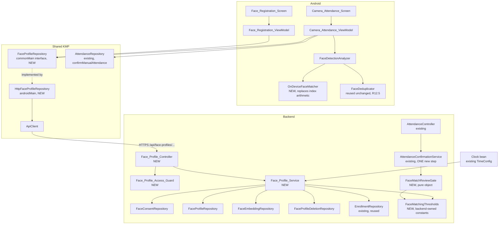
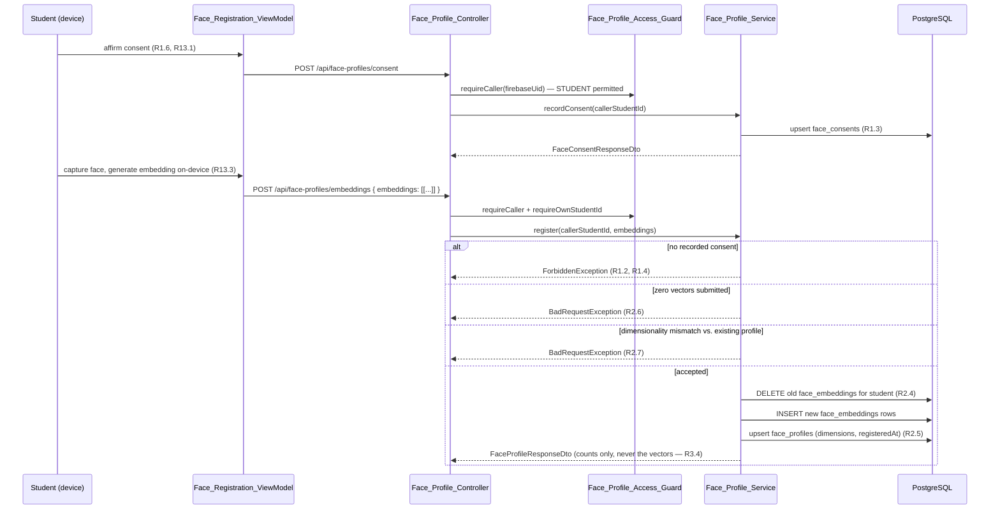
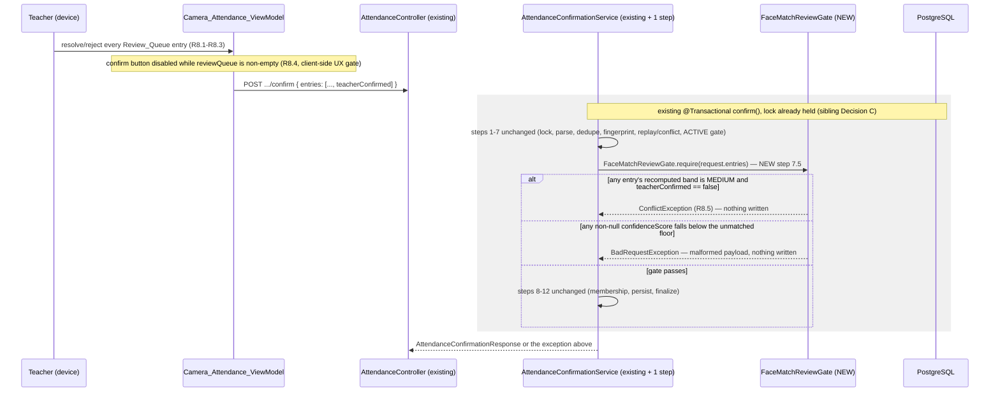

 # Design Document

## Overview

This design adds real on-device face enrollment and matching on top of the live V1–V10 schema and the attendance-marking feature's confirmation flow. It introduces one migration (V11) for four small, append-friendly tables, one `Face_Profile_Service` facade, one `Face_Profile_Controller`, one `Face_Profile_Access_Guard`, four backend DTOs mirrored as four shared KMP wire types, one on-device matching interface replacing the index-arithmetic placeholder in `FaceDetectionAnalyzer.kt`, and a Review_Queue mechanism split between `CameraAttendanceViewModel` (the client-side UX gate) and a new pure object, `FaceMatchReviewGate` (the real server-side gate).

Nothing in attendance-marking's own schema or requirement set changes. `lecture_sessions`, `attendance_records`, `enrollments`, `attendance_submissions` and the four attendance-marking collaborators keep their existing shapes. The one file this feature is required to modify is `AttendanceConfirmationService.kt` — not because this spec redesigns requirement 5/6/7, but because requirement 8.5 of *this* spec can only be enforced inside that method's existing transaction and lock. That modification is scoped to exactly one new step and is described in full in [Settled Decision B](#settled-decision-b--server-side-enforcement-of-the-review-queue-gate).

### Drift From the Sibling Spec

attendance-marking/design.md states, as a settled fact: *"No `method` field either — R5.9 fixes method = MANUAL server-side"* and that `confidenceScore` is always null for a manually-confirmed record. Reading the shipped code shows both claims are already false:

- `ConfirmAttendanceRequestDto` carries a live `method: String?` field, and `AttendanceConfirmationService.confirm()` parses it with `requestedMethod = when (request.method?.uppercase()) { "CAMERA" -> ... }` — the exact field the sibling design's own code comment, written directly above it, says does not exist.
- `confidenceByStudent = request.entries.associate { it.studentId to it.confidenceScore }` persists a client-supplied number verbatim, with no server-side check of any kind.
- `CameraAttendanceViewModel.confirmAttendance()` already calls this endpoint today with `method = "CAMERA"` and a `confidenceScore` sourced from `FaceDetectionAnalyzer.calculateConfidence()` — the fabricated `0.88`-base placeholder this spec exists to replace (see requirements.md's "Background and Correction Note").

This design does not pretend the seam is closed. It treats the already-open `method`/`confidenceScore` fields as the real, load-bearing wire contract for the camera flow — because they already are, in production code — and its job includes closing the actual gap that matters: **nothing today stops a client from submitting a MEDIUM-confidence camera match as a bare PRESENT mark with zero teacher review**, which is a direct violation of requirement 8. [Settled Decision B](#settled-decision-b--server-side-enforcement-of-the-review-queue-gate) is this design's answer to that gap. No other part of `AttendanceConfirmationService` is touched, and no attendance-marking requirement number is renumbered or reinterpreted.

### What this design does not change

- `Lecture_Session`, `SessionStatus`, `Enrollment`, `Attendance_Record`, `AttendanceStatus`, the confirmation step order, the pessimistic lock (Decision C of the sibling spec), and `SessionCounterRecalculator` are reused exactly as attendance-marking defines them.
- `Mark_Attendance_Screen` and its ViewModel are untouched; requirement 10's fallback navigates *to* that existing screen, it does not modify it.
- `GlobalExceptionHandler` is not modified. Every new error path in this feature raises one of the six exception types it already handles.
- No `pgvector` extension, no object storage, no server-side embedding computation or comparison — per requirements' Resolved Decision #1, embeddings are generated and compared only on-device.
- The concrete on-device detection/embedding model, the exact threshold tuning values, liveness/anti-spoofing, and admin tooling are explicitly out of scope (per requirements' Open Items); this design names the interfaces these decisions plug into without pinning the decisions themselves.

---

## Architecture

### Components



`Face_Profile_Service`, `Face_Profile_Controller` and `Face_Profile_Access_Guard` live in a new package, `com.afora.backend.facerecognition`, parallel to `attendance`, `academic` and `user`. `FaceMatchReviewGate` and `FaceMatchingThresholds` also live in that package even though they are *called from* the attendance package — ownership follows the feature that introduced the rule, not the file that invokes it, matching the sibling spec's single-owner convention (see [Settled Decision B](#settled-decision-b--server-side-enforcement-of-the-review-queue-gate)).

### Registration sequence



### Camera confirmation sequence (the enforced gate)



---

## Settled Decisions

### Settled Decision A — Migration version, table shape and the embedding column type

**Version number.** The latest applied migration is `V10__create_device_tokens.sql`. This feature's migration is therefore `V11__create_face_recognition_tables.sql`. (Confirmed input to this design; not re-derived.)

**Four tables, not one.** `face_consents`, `face_profiles`, `face_embeddings` and `face_profile_deletions`.

| Question | Decision | Why |
|---|---|---|
| Does Face_Consent get its own table, or a boolean on `students`? | Its own table, `face_consents(student_id PK, consented_at)` | `students` is owned by the user-management feature; adding a biometric-consent column there would spread this feature's concern across a file this feature does not own. A one-row-per-student table with `student_id` as the primary key gives an O(1) existence check for R1.1/R1.4 with no new index. |
| Does Face_Profile get its own table, separate from the embedding rows? | Yes, `face_profiles(student_id PK, dimensions, registered_at, updated_at)` | R2.4 ("does a profile already exist") and R2.5 (the registration timestamp) need an O(1) lookup that does not scan `face_embeddings`. R2.7's dimensionality check reads `face_profiles.dimensions`, an integer, rather than parsing every stored vector. |
| How is a Face_Embedding vector stored? | `embedding_vector TEXT NOT NULL` holding a comma-delimited list of doubles (e.g. `"0.0123,-0.441,..."`), parsed and serialized only by `Face_Profile_Service` | This is the same reasoning as the sibling spec's Decision A choosing `TEXT` over `jsonb` for `confirmation_json`: a native PostgreSQL `DOUBLE PRECISION[]` column maps through the PostgreSQL JDBC driver's `java.sql.Array` machinery, which does not behave identically against H2's array type, and this project's tests run on H2 under `ddl-auto: validate` while dev runs on PostgreSQL under the same mode. A drift between the two would fail at dev startup, not at test time — exactly the failure class Decision A was written to avoid. `TEXT` maps identically on both engines. The cost is that no SQL in this feature can ever read inside the vector, which requirement 3.3 already mandates anyway ("no embedding comparison in the database or in any backend process"). |
| Why not `pgvector`? | Rejected, per requirements' own Resolved Decision #1 | Not re-litigated here; restated for traceability only. |
| Is R2.7's dimensionality check enforced by the database? | No — enforced in `Face_Profile_Service` at write time | PostgreSQL `CHECK` constraints cannot reference another row or another table, so "this vector's length must equal the dimensionality already on record for this student" cannot be a `CHECK` clause. The database enforces only `dimensions > 0` via `CHECK (dimensions > 0)` on both `face_profiles` and `face_embeddings`; cross-row consistency is the service's job, stated here rather than silently assumed. |
| Does a deletion (Requirement 4) leave an audit trail once the biometric rows are gone? | Yes — a fourth, append-only table, `face_profile_deletions(id, student_id, reason, deleted_at)` | R4.4 requires recording "the deletion timestamp and the triggering reason," but the deletion itself removes `face_consents` and `face_embeddings` rows (R4.3), so there is nowhere left to write that timestamp without a dedicated log. This mirrors `attendance_audit_entries`'s append-only philosophy: never updated, never deleted, growth bounded by deletion volume, not time. `reason` is constrained to the three triggering causes via `CHECK (reason IN (...))`, the same style as `attendance_audit_entries.previous_status`. |
| Do `face_consents`/`face_profiles` get `updated_at` triggers? | No. `Face_Profile_Service` writes `updated_at` explicitly from the existing `Clock` bean (`common/config/TimeConfig.kt`), reused unchanged | Same reasoning as the sibling spec's Decision B: one injected time source, no new abstraction, trivially fixed in tests via `Clock.fixed`. This feature introduces no second `Clock` bean. |

```sql
-- V11__create_face_recognition_tables.sql
-- Face_Consent, Face_Profile and Face_Embedding storage (Requirements 1-4).
-- No face image, no pgvector extension: embeddings are plain delimited TEXT,
-- parsed and serialized only by Face_Profile_Service, for the same cross-engine
-- (H2 test / PostgreSQL dev, both under ddl-auto: validate) reason the sibling
-- attendance-marking migration (V9) chose TEXT over jsonb for confirmation_json.

CREATE TABLE face_consents (
    student_id   BIGINT PRIMARY KEY REFERENCES students(id) ON DELETE CASCADE,
    consented_at TIMESTAMP NOT NULL DEFAULT CURRENT_TIMESTAMP
);

COMMENT ON TABLE face_consents IS
    'One row per student: the single most recent Face_Consent (R1.3). Deleted whenever '
    'face_embeddings rows are purged under Requirement 4 (R4.3), so re-registration after '
    'deletion requires consenting again (R1.1, R1.5).';

CREATE TABLE face_profiles (
    student_id    BIGINT PRIMARY KEY REFERENCES students(id) ON DELETE CASCADE,
    dimensions    INT NOT NULL CHECK (dimensions > 0),
    registered_at TIMESTAMP NOT NULL,
    updated_at    TIMESTAMP NOT NULL
);

COMMENT ON TABLE face_profiles IS
    'One row per student holding a registered Face_Profile. Exists so "does a profile '
    'already exist" (R2.4) and the registration timestamp (R2.5) are O(1) lookups that do '
    'not scan face_embeddings. dimensions caches the vector length so R2.7''s cross-request '
    'dimensionality check never has to parse embedding_vector.';

CREATE TABLE face_embeddings (
    id               BIGSERIAL PRIMARY KEY,
    student_id       BIGINT NOT NULL REFERENCES students(id) ON DELETE CASCADE,
    embedding_vector TEXT NOT NULL,
    dimensions       INT NOT NULL CHECK (dimensions > 0),
    created_at       TIMESTAMP NOT NULL DEFAULT CURRENT_TIMESTAMP
);

CREATE INDEX idx_face_embeddings_student ON face_embeddings(student_id);

COMMENT ON TABLE face_embeddings IS
    'Numeric Face_Embedding vectors only -- never a face image (R3.2). embedding_vector is '
    'a comma-delimited list of doubles, app-parsed. No vector-similarity index, no pgvector '
    'extension (R3.1). No backend process ever compares two of these rows (R3.3).';

CREATE TABLE face_profile_deletions (
    id         BIGSERIAL PRIMARY KEY,
    student_id BIGINT NOT NULL REFERENCES students(id) ON DELETE CASCADE,
    reason     VARCHAR(30) NOT NULL
        CHECK (reason IN ('STUDENT_REQUEST', 'ADMIN_REQUEST', 'ENROLLMENT_ENDED')),
    deleted_at TIMESTAMP NOT NULL DEFAULT CURRENT_TIMESTAMP
);

CREATE INDEX idx_face_profile_deletions_student ON face_profile_deletions(student_id);

COMMENT ON TABLE face_profile_deletions IS
    'Append-only record of every Face_Profile purge (R4.4). Never updated, never deleted. '
    'The only durable trace that a student''s biometric data existed, once face_consents '
    'and face_embeddings rows for that student are gone.';
```

### Settled Decision B — Server-side enforcement of the Review_Queue gate

This is the critical finding from the Overview, made concrete.

**The problem, restated precisely.** Requirement 8.5 requires HTTP 409 when a camera confirmation is submitted while the session's Review_Queue holds an unresolved MEDIUM-confidence entry. Today, `ConfirmAttendanceRequestDto` carries no field a server could use to know whether a MEDIUM match was ever shown to a teacher, let alone resolved. The backend also cannot independently recompute a Match_Confidence, because requirement 3.3/6.5 forbid any backend-side embedding comparison — the backend can only trust the number the device reports.

**What was evaluated and rejected:**

| Alternative | Why rejected |
|---|---|
| Trust the client's self-reported `request.method` field to decide whether the gate applies at all (e.g. only gate when `method == "CAMERA"`) | The client controls both `method` and `confidenceScore`. A client — buggy or malicious — could attach a MEDIUM-range `confidenceScore` while reporting `method = "MANUAL"` (or omitting `method`) and skip the gate entirely. Keying enforcement off a field the submitter controls is exactly the kind of self-certification this finding exists to close. |
| Let the device report its own computed Confidence_Band alongside the score, and have the server trust the band | Same defect as above, one level removed: the device computing "MEDIUM" does not stop a tampered client from relabeling it "HIGH" before submitting. The server must own the band computation if the band is going to gate anything security-relevant. |
| A new pre-check component invoked from `AttendanceController` *before* calling into `AttendanceConfirmationService` | This would need its own read of the session and its own pass over `request.entries` to resolve per-entry confidence, duplicating parsing logic that `AttendanceConfirmationService.confirm()` already performs at its step 3. Two independent parsers of the same payload is precisely the shape of the two drift bugs the sibling spec's Wire Contract section was written to prevent (`semesterId` typed `Long` vs. `uuid`; `mockito-kotlin` vs. `mockk`). Worse, a controller-level pre-check reads the session *before* `findByIdForUpdate`'s pessimistic lock is acquired inside the service, which reopens exactly the kind of unlocked-read race the sibling spec's Decision C was written to close for criterion 6.11. |
| A database `CHECK` constraint on `attendance_records` | A `CHECK` constraint can only see the row being inserted; it has no way to know whether a *different* row in the batch is an unresolved MEDIUM match, and no way to carry "teacher confirmed this" as anything but a column already written by the application that the constraint would then be checking against itself — it would not add any guarantee the application code does not already provide more legibly. |

**The chosen mechanism, concretely:**

1. **One new field on the existing wire payload.** `SubmittedAttendanceEntry` (both `attendance/dto/AttendanceDto.kt` and shared `AttendanceWire.kt`) gains `teacherConfirmed: Boolean = false`. Defaulted `false` on both sides, so every existing manual-marking payload — which never sets `confidenceScore` in the first place — is unaffected: the gate below only ever looks at `teacherConfirmed` for an entry that *also* carries a non-null `confidenceScore`, and manual entries never do.
2. **The backend, not the client, owns the three threshold values.** A new object, `FaceMatchingThresholds`, in the `facerecognition.service` package:
   ```kotlin
   object FaceMatchingThresholds {
       // Placeholder values pending real model tuning (requirements' own Open Items).
       // Not derived from any benchmark; High > Medium >= Floor per R7.4.
       const val HIGH_CONFIDENCE: Double = 0.80
       const val MEDIUM_CONFIDENCE: Double = 0.60
       const val UNMATCHED_FLOOR: Double = 0.60
   }
   ```
   These same three constants are returned to the device inside the `EnrolledEmbeddingSetResponse` (see [Wire Contract](#wire-contract)), so the device's own HIGH/MEDIUM/unmatched classification (requirement 7, a UX concern) and the backend's recomputation (this decision, a security concern) read from one source of truth. The device never sends threshold values to the server; it only ever receives them.
3. **A new pure object recomputes the band server-side and gates on it**, `FaceMatchReviewGate` in `facerecognition/service/FaceMatchReviewGate.kt`:
   ```kotlin
   object FaceMatchReviewGate {
       /**
        * R8.5. Gated on confidenceScore being present, not on request.method,
        * so a client cannot bypass the gate by mislabeling the method (see
        * the rejected alternatives above). Entries with a null confidenceScore
        * (manual marks, or a HIGH match the teacher simply left as-is) are
        * untouched.
        */
       fun require(
           entries: List<SubmittedAttendanceEntry>,
           thresholds: FaceMatchingThresholds = FaceMatchingThresholds
       ) {
           val unresolved = mutableListOf<Long>()
           val invalid = mutableListOf<Long>()
           for (entry in entries) {
               val score = entry.confidenceScore ?: continue
               when {
                   score >= thresholds.HIGH_CONFIDENCE -> Unit // HIGH: no gate (R7.5)
                   score >= thresholds.MEDIUM_CONFIDENCE ->
                       if (!entry.teacherConfirmed) unresolved += entry.studentId // R8.1-R8.2
                   else -> invalid += entry.studentId // below the floor must carry no score (R7.3, R9.3)
               }
           }
           if (invalid.isNotEmpty()) throw BadRequestException(
               "Entries carry a confidenceScore below the matching floor with no corresponding " +
                   "Face_Match_Candidate: ${invalid.sorted()}"
           )
           if (unresolved.isNotEmpty()) throw ConflictException(
               "Camera confirmation blocked: ${unresolved.size} medium-confidence match(es) require " +
                   "teacher confirmation before this session can finalize: ${unresolved.sorted()}"
           )
       }
   }
   ```
4. **Where it is called: inside `AttendanceConfirmationService.confirm()`, as a new step 7.5**, immediately after the existing step 7 (the ACTIVE-status gate / replay-or-conflict resolution) and before the existing step 8 (membership and completeness validation):

   ```kotlin
   // existing step 7: status != ACTIVE -> ConflictException ...

   // NEW step 7.5 (R8.5): rejects outright, before any record is built or written.
   FaceMatchReviewGate.require(request.entries)

   // existing step 8: membership + completeness ...
   ```

   This placement is deliberate, for the same reason the sibling spec's steps are ordered the way they are: it runs **after** the replay/conflict decision at steps 6–7, so a genuine replay of an already-accepted camera confirmation (identical fingerprint) returns the stored response without ever re-running the gate — exactly like it skips the sibling's own validation at step 8. It runs **before** any record is built or persisted, inside the transaction and behind the pessimistic lock already acquired at step 1, so a rejection here leaves nothing behind, preserving the same "no attendance record exists without a successful confirmation" invariant the sibling design relies on elsewhere.

**Blast radius on the sibling's file, stated plainly, Decision-C style:** one new import (`com.afora.backend.facerecognition.service.FaceMatchReviewGate`), one new line inside the existing `confirm()` method, zero changed signatures, zero changed existing steps. `AttendanceConfirmationService`'s constructor is unchanged — `FaceMatchReviewGate` is a parameterless Kotlin `object`, not a Spring bean, so there is no new constructor dependency to wire through `AttendanceService`'s facade or any test's mock setup.

**What this does *not* fix.** The backend still cannot prove a submitted `confidenceScore` is honest — it can only prove that whatever score was submitted was properly routed through teacher review when it fell in the MEDIUM band. A client that lies about a HIGH score to dodge review entirely is a model/liveness problem (explicitly out of scope per requirements) rather than a review-queue-gating problem, and server-side detection of that would require the backend to compute its own embedding comparison, which requirement 3.3 forbids. This design closes exactly the gap requirement 8.5 describes, not a broader one.

### Settled Decision C — The purge hook for Requirement 4 has no existing call site to attach to

Requirement 4.1 requires the purge to run "within the same database transaction" as "a Student's Enrollment status change results in zero remaining ACTIVE Enrollment rows." Searching the backend for any code that writes `Enrollment.status` — an `EnrollmentController`, an `EnrollmentService`, any `enrollmentRepository.save(...)` call outside a test — returns **nothing**. No feature in this codebase currently changes enrollment status at runtime; `EnrollmentRepository` is read-only in every production code path today. This is stated here because it changes what this decision can honestly commit to: there is no live integration point to wire into, only one to define for whenever such a feature arrives.

| Alternative | Decision |
|---|---|
| A Spring `@TransactionalEventListener(phase = BEFORE_COMMIT)` consuming an `EnrollmentStatusChangedEvent` that some future feature would publish | **Rejected.** It would decouple `Face_Profile_Service` from needing to know every future call site, which sounds appealing, but it creates an invisible contract: a future engineer changing enrollment status without knowing an event must be published would silently fail to purge biometric data, with no compiler error and no test failure pointing at the cause. For a privacy-sensitive deletion requirement, a silent miss is worse than a loud coupling. |
| A direct, explicit method on `Face_Profile_Service` that any future enrollment-mutation code must call inline, in its own `@Transactional` method | **Chosen.** `Face_Profile_Service.purgeIfLastActiveEnrollmentEnded(studentId: Long)`. Any code that writes a non-ACTIVE `Enrollment.status` must call this before its own transaction commits. Because it is a normal method call, a future PR that adds enrollment mutation and skips it is just a missing line, visible in the diff and the service's own KDoc, not an unobserved event that never fired. |

**Flagged honestly:** this decision adds `purgeIfLastActiveEnrollmentEnded` and documents it as mandatory for whichever future spec implements enrollment status mutation. It is not called from anywhere in the current codebase, because nothing currently changes enrollment status. The two call sites this feature *does* wire up end-to-end are the explicit ones requirement 4 also requires: a student's own deletion request (R4.2) and an admin's deletion request naming a student (R4.7), both reachable today through the new `DELETE /api/face-profiles/{studentId}` endpoint, each a single `@Transactional` method with a real, exercised call site.

**How this is tested**

Because there is no live call site, this decision is tested in exactly two places. First, a unit test on `FaceProfileService.deleteProfile()` exercises the two call sites that DO exist today — student self-delete and admin-named-delete — asserting all four writes (face_embeddings deleted, face_consents deleted, face_profiles deleted, one face_profile_deletions row inserted with the correct reason) happen or none do, i.e. that the method is atomic. This uses the same `@DataJpaTest` plus real-transaction technique already used elsewhere in this codebase's repository tests, where an induced failure after the first write is used to assert nothing partial survives a rollback.

Second, `purgeIfLastActiveEnrollmentEnded` itself gets one narrow unit test proving it behaves correctly in isolation: given a studentId with zero remaining ACTIVE enrollments, it purges; given at least one remaining ACTIVE enrollment, it is a no-op. Stated plainly: this test cannot prove requirement 4.1's "same transaction as the enrollment status change" clause, because no code calls this method inside such a transaction yet. That gap closes only when a future spec implements enrollment mutation and wires the call. This spec's test suite cannot and does not claim to cover that integration path — the gap is named here in the test plan rather than silently passed over, consistent with how this entire decision was written.

### Settled Decision D — One controller, authorization delegated to a new guard that cannot reuse `AttendanceAccessGuard.requireCaller` as-is

**Reuse, with one necessary deviation, stated explicitly.** `AttendanceAccessGuard.requireCaller()` resolves a Firebase UID to a `CallerContext` using exactly the idiom this design wants to reuse (`.orElseThrow {}`, never elvis on `Optional<User>`) — but it hard-rejects `UserRole.STUDENT` with `ForbiddenException`, which is correct for attendance-marking (students never mark attendance) and wrong here (a student is the primary caller for consent, registration and self-deletion, requirements 1, 2 and 4). Teaching `AttendanceAccessGuard` a face-recognition-specific exception to its STUDENT rule would couple an attendance-marking-owned file to this feature's role rules — the opposite of the single-owner-file discipline the sibling spec itself establishes. So:

- **Reused as-is:** the `CallerContext` data class, imported from `com.afora.backend.attendance.security`, so there is exactly one representation of "the resolved caller" in the backend, not two.
- **Not reused, deliberately duplicated with one rule inverted:** the UID→`CallerContext` resolution method itself, as `Face_Profile_Access_Guard.requireCaller()`, identical to `AttendanceAccessGuard.requireCaller()` except it returns a `STUDENT` `CallerContext` instead of throwing.

```kotlin
// facerecognition/security/FaceProfileAccessGuard.kt
@Component
class FaceProfileAccessGuard(
    private val userRepository: UserRepository,
    private val studentRepository: StudentRepository,
    private val teacherRepository: TeacherRepository,
    private val classSectionRepository: ClassSectionRepository
) {
    /** R11.1, R11.2. Identical resolution to AttendanceAccessGuard, except STUDENT is permitted. */
    fun requireCaller(firebaseUid: String?): CallerContext

    /** R11.3, R11.4: a STUDENT caller's own identifier, or ADMIN acting on a named studentId. */
    fun requireOwnOrAdminStudentId(caller: CallerContext, pathStudentId: Long): Long

    /** R5.4-R5.7, R11.5-R11.7: TEACHER must own the Class_Section; STUDENT is always forbidden. */
    fun requireClassSectionAccess(caller: CallerContext, classSectionId: Long)
}
```

Rules, each traceable:

- No Firebase UID → `UnauthorizedException` (R11.1).
- Unknown UID → `UnauthorizedException` (R11.2).
- `STUDENT` acting on a `pathStudentId` that is not their own resolved `studentId` → `ForbiddenException` (R11.4).
- `STUDENT` calling the embeddings-distribution endpoint at all → `ForbiddenException` (R5.7, R11.7).
- `TEACHER` requesting a Class_Section's embeddings where `classSection.teacher.id != caller.teacherId` → `ForbiddenException` (R5.5, R11.5).
- `ADMIN` → unrestricted on every operation this guard checks (R5.6, R11.6).

**How this is tested**

`FaceProfileAccessGuard` is a plain `@Component` with no transactional or locking concerns — unlike the sibling spec's `AttendanceAccessGuard`, which Decision C's own test discussion treats as needing a real concurrency test. It is fully covered by ordinary MockK-based unit tests, one per bullet in the "Rules, each traceable" list above: null UID, unknown UID, STUDENT acting on someone else's studentId, STUDENT calling the embeddings endpoint, TEACHER on a class section they do not own, and ADMIN bypassing every check. Test file: `backend/src/test/kotlin/com/afora/backend/facerecognition/security/FaceProfileAccessGuardTest.kt`.

One specific risk this test suite must guard against, stated honestly: because this guard duplicates `AttendanceAccessGuard`'s resolution logic rather than extending it (as this same Decision D explains above), a bug fix later applied to one guard's UID-resolution logic could silently fail to be applied to the other. The test file's own header comment should say this plainly, so a future reader fixing a bug in `AttendanceAccessGuard` is prompted to check whether `FaceProfileAccessGuard` needs the identical fix. This is a known-and-accepted cost of the duplication Decision D already chose, named here rather than left implicit.

One controller, `Face_Profile_Controller`, mapped `@RequestMapping("/face-profiles")`, resolving to `/api/face-profiles` under the project's `server.servlet.context-path: /api`. Four endpoints is not enough surface to justify a split, and all four share one guard — the same reasoning the sibling spec's Decision D used to keep `AttendanceController` singular.

| Method | Path (deployed) | Operation | Requirement |
|---|---|---|---|
| POST | `/api/face-profiles/consent` | Record Face_Consent for the caller | 1 |
| POST | `/api/face-profiles/embeddings` | Register (replace) the caller's Face_Profile | 2 |
| DELETE | `/api/face-profiles/{studentId}` | Delete a Face_Profile — self (student) or named (admin) | 4 |
| GET | `/api/face-profiles/class-sections/{classSectionId}/enrolled-embeddings` | Distribute the Enrolled_Embedding_Set | 5 |

**No `studentId` field in the consent or registration request bodies.** Both are derived entirely from the authenticated caller, the same reasoning as the sibling spec's "no `sessionId` in the confirm body": it removes the entire class of bug where a request body names a different student than the one actually authenticated, and makes R2.8 ("permit registration only for that Student's own identifier") true by construction rather than by a check that could be forgotten. `DELETE` is the one operation that must name a student in the path, because an admin must be able to target someone other than themselves (R4.7).

---

## Components and Interfaces

### Backend

#### `Face_Profile_Service` — `facerecognition/service/FaceProfileService.kt`

```kotlin
@Service
class FaceProfileService(
    private val faceConsentRepository: FaceConsentRepository,
    private val faceProfileRepository: FaceProfileRepository,
    private val faceEmbeddingRepository: FaceEmbeddingRepository,
    private val faceProfileDeletionRepository: FaceProfileDeletionRepository,
    private val enrollmentRepository: EnrollmentRepository,   // existing, reused
    private val clock: Clock                                  // existing bean, reused
) {
    @Transactional
    fun recordConsent(studentId: Long): FaceConsentResponseDto

    @Transactional
    fun register(studentId: Long, embeddings: List<List<Double>>): FaceProfileResponseDto

    @Transactional
    fun deleteProfile(studentId: Long, reason: PurgeReason): FaceProfileDeletionResponseDto

    @Transactional(readOnly = true)
    fun enrolledEmbeddingSet(classSectionId: Long): EnrolledEmbeddingSetResponseDto

    /** See Settled Decision C. Not called from anywhere in this codebase today. */
    @Transactional
    fun purgeIfLastActiveEnrollmentEnded(studentId: Long)
}

enum class PurgeReason { STUDENT_REQUEST, ADMIN_REQUEST, ENROLLMENT_ENDED }
```

**`register` flow** (R2.1–R2.8):

1. `faceConsentRepository.existsById(studentId)` false → `ForbiddenException` (R1.2, R1.4).
2. `embeddings.isEmpty()` → `BadRequestException` (R2.6).
3. `embeddings.map { it.size }.distinct().size > 1` (vectors within one request disagree on length) → `BadRequestException`. This is a design-level extension of R2.7, not literally spelled out in the EARS text, but implied by the chosen data model: `face_profiles.dimensions` is a single integer, so a Face_Profile cannot have two dimensionalities even within one registration. Flagged here rather than silently assumed.
4. `faceProfileRepository.findById(studentId)` present and its `dimensions != embeddings.first().size` → `BadRequestException` (R2.7).
5. `faceEmbeddingRepository.deleteByStudentId(studentId)` then insert one `FaceEmbedding` row per vector, each serialized to comma-delimited `TEXT` (R2.4, R3.1, R3.2).
6. Upsert `face_profiles`: `dimensions = embeddings.first().size`, `registeredAt = LocalDateTime.now(clock)` only if no row existed before, else keep the original `registeredAt` and update only `updatedAt` (R2.5).
7. Return `FaceProfileResponseDto(studentId, embeddingCount = embeddings.size, dimensions, registeredAt)` — **never the vectors themselves** (R3.4).

**`deleteProfile` flow** (R4.2, R4.3, R4.4, R4.6, R4.7):

1. `faceEmbeddingRepository.deleteByStudentId(studentId)`.
2. `faceConsentRepository.deleteById(studentId)` (R4.3).
3. `faceProfileRepository.deleteById(studentId)`.
4. Insert one `FaceProfileDeletion(studentId, reason, deletedAt = LocalDateTime.now(clock))` row (R4.4) — this row is the only thing that survives.
5. All four writes are one `@Transactional` method, so partial deletion cannot occur.

**`enrolledEmbeddingSet` flow** (R5.1–R5.9):

1. `enrollmentRepository.findActiveRosterByClassSectionId(classSectionId)` — the exact query the sibling attendance-marking feature already added to `EnrollmentRepository`, reused unchanged rather than duplicated (R5.1, R5.2).
2. `faceEmbeddingRepository.findByStudentIdIn(activeStudentIds)`, grouped by `studentId` in Kotlin.
3. Students with zero grouped embeddings are dropped from the result (R5.3); a Class_Section with no qualifying students returns `entries = []`, never null (R5.8).
4. Each remaining student's rows are parsed from `embedding_vector` back into `List<Double>` and collected into one entry carrying every one of that student's vectors plus their `studentId` (R5.9).
5. Response also carries `FaceMatchingThresholds.HIGH_CONFIDENCE`, `.MEDIUM_CONFIDENCE`, `.UNMATCHED_FLOOR` — the backend-owned values the device must use for its own HIGH/MEDIUM/unmatched classification (requirement 7), so there is exactly one source of truth for all three threshold values, shared by this response and by `FaceMatchReviewGate`.

#### `Face_Profile_Controller` — `facerecognition/controller/FaceProfileController.kt`

Four methods, each three lines: resolve the caller through the guard, resolve/compare the identifier the guard requires for that operation, delegate. Every body wrapped in `ApiResponse.success(...)`, matching the rest of the project — including the state-changing `POST`s, which return `200 OK` rather than `201 Created`, the same convention `AttendanceController` already uses for `activate`/`confirm`.

```kotlin
@RestController
@RequestMapping("/face-profiles")
class FaceProfileController(
    private val faceProfileService: FaceProfileService,
    private val accessGuard: FaceProfileAccessGuard,
    private val studentRepository: StudentRepository
) {
    @PostMapping("/consent")
    fun recordConsent(@AuthenticationPrincipal firebaseUid: String?): ResponseEntity<ApiResponse<FaceConsentResponseDto>> {
        val caller = accessGuard.requireCaller(firebaseUid)
        val studentId = requireStudentCaller(caller) // ForbiddenException for TEACHER/ADMIN — only a student has a profile to consent for
        return ResponseEntity.ok(ApiResponse.success(faceProfileService.recordConsent(studentId)))
    }
    // register, delete, enrolledEmbeddings follow the identical resolve-then-delegate shape
}
```

#### `FaceMatchReviewGate` and `FaceMatchingThresholds`

Specified in full in [Settled Decision B](#settled-decision-b--server-side-enforcement-of-the-review-queue-gate).

### New backend entities and repositories

Scalar `Long` foreign-key columns, not `@ManyToOne` associations — the same reasoning the sibling spec gave for `AttendanceSubmission`/`AttendanceAuditEntry`: none of these rows is ever navigated as an object graph, each is written once and read as a flat projection, and scalar columns keep `@DataJpaTest` setup to a single constructor call with no lazy-proxy surprises.

```kotlin
// facerecognition/entity/FaceConsent.kt
@Entity @Table(name = "face_consents")
data class FaceConsent(
    @Id @Column(name = "student_id") val studentId: Long = 0,
    @Column(nullable = false) val consentedAt: LocalDateTime = LocalDateTime.now()
)

// facerecognition/entity/FaceProfile.kt
@Entity @Table(name = "face_profiles")
data class FaceProfile(
    @Id @Column(name = "student_id") val studentId: Long = 0,
    @Column(nullable = false) val dimensions: Int = 0,
    @Column(nullable = false) val registeredAt: LocalDateTime = LocalDateTime.now(),
    @Column(nullable = false) val updatedAt: LocalDateTime = LocalDateTime.now()
)

// facerecognition/entity/FaceEmbedding.kt
@Entity @Table(name = "face_embeddings")
data class FaceEmbedding(
    @Id @GeneratedValue(strategy = GenerationType.IDENTITY) val id: Long = 0,
    @Column(name = "student_id", nullable = false, updatable = false) val studentId: Long = 0,
    @Column(name = "embedding_vector", nullable = false, columnDefinition = "TEXT", updatable = false)
    val embeddingVector: String = "",
    @Column(nullable = false, updatable = false) val dimensions: Int = 0,
    @Column(nullable = false, updatable = false) val createdAt: LocalDateTime = LocalDateTime.now()
)

// facerecognition/entity/FaceProfileDeletion.kt
@Entity @Table(name = "face_profile_deletions")
data class FaceProfileDeletion(
    @Id @GeneratedValue(strategy = GenerationType.IDENTITY) val id: Long = 0,
    @Column(name = "student_id", nullable = false, updatable = false) val studentId: Long = 0,
    @Enumerated(EnumType.STRING)
    @Column(nullable = false, updatable = false, length = 30) val reason: PurgeReason = PurgeReason.STUDENT_REQUEST,
    @Column(nullable = false, updatable = false) val deletedAt: LocalDateTime = LocalDateTime.now()
)
```

```kotlin
interface FaceConsentRepository : JpaRepository<FaceConsent, Long>

interface FaceProfileRepository : JpaRepository<FaceProfile, Long>

interface FaceEmbeddingRepository : JpaRepository<FaceEmbedding, Long> {
    fun findByStudentId(studentId: Long): List<FaceEmbedding>
    fun findByStudentIdIn(studentIds: Collection<Long>): List<FaceEmbedding>
    fun deleteByStudentId(studentId: Long): Long
    fun existsByStudentId(studentId: Long): Boolean
}

interface FaceProfileDeletionRepository : JpaRepository<FaceProfileDeletion, Long>
```

No change to `EnrollmentRepository`, `AttendanceRecordRepository` or any other existing repository. `enrolledEmbeddingSet` reuses `EnrollmentRepository.findActiveRosterByClassSectionId`, already added by the sibling spec.

### Shared KMP and Android

#### `FaceProfileWire.kt` — `shared/.../data/api/FaceProfileWire.kt` (new)

Follows `AttendanceWire.kt`'s established conventions exactly: one `@Serializable` type per payload, no domain mirror, timestamps as plain ISO-8601 `String`, entity identifiers as `Long`.

```kotlin
@Serializable
data class RegisterFaceProfileRequest(val embeddings: List<List<Double>>)

@Serializable
data class FaceProfileResponse(
    val studentId: Long,
    val embeddingCount: Int,
    val dimensions: Int,
    val registeredAt: String
)

@Serializable
data class FaceConsentResponse(val studentId: Long, val consentedAt: String)

@Serializable
data class FaceProfileDeletionResponse(val studentId: Long, val reason: String, val deletedAt: String)

@Serializable
data class EnrolledEmbeddingSetResponse(
    val classSectionId: Long,
    val entries: List<EnrolledEmbeddingEntry> = emptyList(),
    val highConfidenceThreshold: Double,
    val mediumConfidenceThreshold: Double,
    val unmatchedFloorThreshold: Double
)

@Serializable
data class EnrolledEmbeddingEntry(
    val studentId: Long,
    val rollNumber: String,
    val fullName: String,
    val embeddings: List<List<Double>>
)
```

#### `FaceProfileRepository` — `commonMain/data/repository/FaceProfileRepository.kt` (new interface)

```kotlin
interface FaceProfileRepository {
    suspend fun recordConsent(): Result<FaceConsentResponse>
    suspend fun registerFaceProfile(embeddings: List<List<Double>>): Result<FaceProfileResponse>
    suspend fun deleteFaceProfile(studentId: Long): Result<FaceProfileDeletionResponse>
    suspend fun getEnrolledEmbeddingSet(classSectionId: Long): Result<EnrolledEmbeddingSetResponse>
}
```

`HttpFaceProfileRepository` (androidMain) follows `HttpAttendanceRepository`'s pattern exactly: constructor-injected `ApiClient`, full `/api/face-profiles/...` endpoint strings, `result.data.data` unwrapping, `AppError` on failure.

#### Changes to the existing `AttendanceWire.kt` and backend `AttendanceDto.kt`

The one wire-level change this feature makes to the sibling spec's files:

```kotlin
// both backend attendance/dto/AttendanceDto.kt and shared AttendanceWire.kt
data class SubmittedAttendanceEntry(
    val studentId: Long,
    val status: String,          // unchanged
    val notes: String? = null,   // unchanged
    val confidenceScore: Double? = null, // unchanged
    val teacherConfirmed: Boolean = false // NEW (R8.5)
)
```

Additive and defaulted, so every existing manual-marking call site compiles and behaves identically — manual entries never set `confidenceScore`, so `FaceMatchReviewGate` never inspects their `teacherConfirmed` value either.

#### On-device matching — `OnDeviceFaceMatcher`, replacing `matchStudentForFace`/`calculateConfidence`

`FaceDetectionAnalyzer.kt`'s `matchStudentForFace` (index arithmetic: `abs(trackingId) % enrolledStudents.size`) and `calculateConfidence` (fixed `0.88` base) are replaced by calls into a new interface, `OnDeviceFaceMatcher`, in the same `androidApp/.../ui/attendance/camera` package (R12.1–R12.4):

```kotlin
interface OnDeviceFaceMatcher {
    /** R6.1: generates a Face_Embedding from one detected face, entirely on-device. */
    fun generateEmbedding(face: Face, frame: InputImage): FloatArray

    /**
     * R6.2-R6.4: compares the embedding against every entry in the distributed set and
     * returns the single best match, or null if every candidate falls below the
     * Unmatched_Floor_Threshold (R7.3) — in which case no Face_Match_Candidate exists
     * at all, by contract, and the caller must not fabricate one.
     */
    fun match(embedding: FloatArray, enrolledSet: List<EnrolledEmbedding>): FaceMatchCandidate?
}

data class EnrolledEmbedding(
    val studentId: Long,
    val rollNumber: String,
    val fullName: String,
    val vectors: List<FloatArray>
)

data class FaceMatchCandidate(
    val studentId: Long,
    val rollNumber: String,
    val fullName: String,
    val matchConfidence: Double,     // R6.3: derived solely from the embedding comparison
    val confidenceBand: ConfidenceBand, // R7.1-R7.2: HIGH or MEDIUM only; below-floor never materializes a candidate
    val trackingId: Int?
)

enum class ConfidenceBand { HIGH, MEDIUM }
```

The concrete embedding model/library (MobileFaceNet, ArcFace, or otherwise) and the resulting vector dimensionality are **not** pinned by this design — per requirements' own Open Items, that remains an implementation-time choice. What this design fixes is the contract: an embedding in, a nullable `FaceMatchCandidate` out, with `matchConfidence` and `confidenceBand` computed only from the embedding comparison, never from `trackingId` or frame-detection index (R6.3, R12.3). `FaceDeduplicator`'s cross-frame retention (keep the highest-confidence evaluation per tracked identity) needs no code change — it already operates on `DetectedFaceCandidate.confidence`/`.category`, which, once `FaceDetectionAnalyzer` is wired to `OnDeviceFaceMatcher`, carry genuine `matchConfidence`/`confidenceBand` values instead of the fabricated ones (R12.5, as requirements explicitly anticipates). `CameraAttendanceModels.kt`'s `DetectedFaceCandidate` gains one new field, `teacherConfirmed: Boolean = false`, to carry the Review_Queue resolution through to the confirm request (below); `ConfidenceCategory.LOW` is no longer produced by the new matcher (there are only two live bands, HIGH and MEDIUM — anything else is "no candidate," not a third band) and is left in place but unused by this feature rather than deleted, since deleting it is a UI-layer cleanup outside this design's scope.

#### Review_Queue — `CameraAttendanceViewModel` additions

A new state field alongside the existing `candidates` map, holding only unresolved MEDIUM matches:

```kotlin
data class Ready(
    // ...existing fields...
    val reviewQueue: Map<Long, FaceMatchCandidate> = emptyMap() // R8.1: unresolved MEDIUM matches only
) {
    val confirmEnabled: Boolean get() = reviewQueue.isEmpty() // R8.4, client-side UX gate
}
```

Routing on each detection batch (R7.5–R7.7): a `HIGH`-band candidate is written directly into `candidates`, pre-selected `PRESENT`, overridable; a `MEDIUM`-band candidate is written into `reviewQueue` instead, never into `candidates`, until resolved; `null` (no candidate at all) touches neither map, leaving that face presented as unmatched. Where two `MEDIUM` candidates in the queue name the same student, the one with the higher `matchConfidence` is kept and the other discarded (R8.7) — the same highest-confidence-wins rule `FaceDeduplicator` already applies elsewhere, applied here to the queue instead of to `candidates`.

```kotlin
fun confirmReviewEntry(studentId: Long) {
    // R8.2: moves the entry into candidates with attendanceStatus = PRESENT and
    // teacherConfirmed = true, and removes it from reviewQueue.
}

fun rejectReviewEntry(studentId: Long) {
    // R8.3: removes the entry from reviewQueue only. No automatic status is set;
    // the existing confirmAttendance() default-to-ABSENT behavior for a student
    // with no candidate applies unchanged.
}
```

`confirmAttendance()`'s existing entry-building loop gains one line: `teacherConfirmed = candidate?.teacherConfirmed ?: false` on each `SubmittedAttendanceEntry` it constructs. That is the one line that connects the client-side UX gate (`confirmEnabled`, disabling the button) to the real, enforced server-side gate (`FaceMatchReviewGate`) — the button disable is a convenience that can be bypassed by a modified client; `FaceMatchReviewGate` is what actually matters, which is the entire point of Settled Decision B.

#### Fallback to Mark_Attendance_Screen (Requirement 10)

A design-level note, not a new component: `Camera_Attendance_ViewModel` already navigates away from itself today via its `uiState` sealed interface. Requirement 10's three triggers — an empty `EnrolledEmbeddingSet` (R10.1), a scanning pass that produces zero `FaceMatchCandidate`s for the whole roster (R10.2), and an unrecoverable matcher error (R10.3) — all route to the same existing `Mark_Attendance_Screen` navigation target, carrying the session's `sessionId`. None of them call `cancel` or `confirm`, so `SessionStatus` stays `ACTIVE` (R10.4), and none of them clear `reviewQueue` or `candidates` before navigating (R10.5) — if the teacher returns to the camera screen, prior resolutions are intact.

---

## Data Models

Covered in full in [Settled Decision A](#settled-decision-a--migration-version-table-shape-and-the-embedding-column-type).

---

## Wire Contract

This section is normative, the same way the sibling spec's Wire Contract is: the backend DTOs and the shared `@Serializable` types implement these tables field for field.

### Scalar conventions

Identical to the sibling spec's table: entity identifiers are `Long`/`BIGINT`, timestamps are plain `String` (`ISO_LOCAL_DATE_TIME`, no zone, no `Z`) on the shared side and `LocalDateTime` on the backend side. No new convention is introduced.

### `POST /api/face-profiles/consent` → `FaceConsentResponse`

No request body.

| Field | Type | Nullable | Example | Requirement |
|---|---|---|---|---|
| `studentId` | number | no | `101` | 1.3 |
| `consentedAt` | string timestamp | no | `"2026-03-01T09:00:00"` | 1.3 |

### `POST /api/face-profiles/embeddings` → request `RegisterFaceProfileRequest`

| Field | Type | Nullable | Example | Requirement |
|---|---|---|---|---|
| `embeddings` | array of array of number, non-empty | no | `[[0.12, -0.44, ...], [0.09, -0.41, ...]]` | 2.1, 2.3 |

No `studentId` field — derived from the authenticated caller (Settled Decision D).

### `POST /api/face-profiles/embeddings` → response `FaceProfileResponse`

| Field | Type | Nullable | Example | Requirement |
|---|---|---|---|---|
| `studentId` | number | no | `101` | 2.1 |
| `embeddingCount` | number | no | `2` | 13.4 |
| `dimensions` | number | no | `128` (illustrative only — not pinned by this design) | 2.7 |
| `registeredAt` | string timestamp | no | `"2026-03-01T09:02:11"` | 2.5 |

Never includes the vectors themselves (R3.4).

### `DELETE /api/face-profiles/{studentId}` → `FaceProfileDeletionResponse`

No request body.

| Field | Type | Nullable | Example | Requirement |
|---|---|---|---|---|
| `studentId` | number | no | `101` | 4.2, 4.7 |
| `reason` | string, one of `STUDENT_REQUEST` / `ADMIN_REQUEST` / `ENROLLMENT_ENDED` | no | `"STUDENT_REQUEST"` | 4.4 |
| `deletedAt` | string timestamp | no | `"2026-03-02T14:10:00"` | 4.4 |

### `GET /api/face-profiles/class-sections/{classSectionId}/enrolled-embeddings` → `EnrolledEmbeddingSetResponse`

| Field | Type | Nullable | Example | Requirement |
|---|---|---|---|---|
| `classSectionId` | number | no | `7` | 5.9 |
| `entries` | array of `EnrolledEmbeddingEntry` (`[]` when none) | no | `[…]` | 5.1, 5.8 |
| `highConfidenceThreshold` | number | no | `0.80` | Settled Decision B |
| `mediumConfidenceThreshold` | number | no | `0.60` | Settled Decision B |
| `unmatchedFloorThreshold` | number | no | `0.60` | Settled Decision B |

`EnrolledEmbeddingEntry`:

| Field | Type | Nullable | Example | Requirement |
|---|---|---|---|---|
| `studentId` | number | no | `101` | 5.9 |
| `rollNumber` | string | no | `"2024CS001"` | 5.9 |
| `fullName` | string | no | `"Asha Menon"` | 5.9 |
| `embeddings` | array of array of number | no | `[[0.12, -0.44, ...]]` | 5.9 |

### Change to the sibling spec's `POST .../confirm` request, `SubmittedAttendanceEntry`

| Field | Type (shared) | Type (backend DTO) | Nullable | Default | Example | Requirement |
|---|---|---|---|---|---|---|
| `teacherConfirmed` | `Boolean` | `Boolean` | no | `false` | `true` | 8.5 (this spec) |

Every other field of `SubmittedAttendanceEntry`, `ConfirmAttendanceRequest/Dto` and `AttendanceConfirmationResponse` is unchanged.

### The error envelope

Unchanged shape (`ApiResponse.error`), with new `details` keys for this feature's failure modes:

| Key | Type | Raised by | Requirement |
|---|---|---|---|
| `unresolvedReviewStudentIds` | array of number | Camera confirmation with an unconfirmed MEDIUM match | 8.5 |
| `invalidConfidenceStudentIds` | array of number | A submitted `confidenceScore` below the matching floor | 7.3, 9.3 (implied) |

---

## Error Handling

`GlobalExceptionHandler` is not modified. Every new path raises one of its six existing exception types.

| Condition | Exception | Status | `code` | `details` key | Requirement |
|---|---|---|---|---|---|
| No Firebase principal | `UnauthorizedException` | 401 | `UNAUTHORIZED` | — | 11.1 |
| Firebase uid matches no user | `UnauthorizedException` | 401 | `UNAUTHORIZED` | — | 11.2 |
| Registration/consent/delete with no recorded consent (register only) | `ForbiddenException` | 403 | `FORBIDDEN` | — | 1.2, 1.4 |
| STUDENT acting on a `studentId` other than their own | `ForbiddenException` | 403 | `FORBIDDEN` | — | 11.4 |
| STUDENT requesting an Enrolled_Embedding_Set | `ForbiddenException` | 403 | `FORBIDDEN` | — | 5.7, 11.7 |
| TEACHER requesting a Class_Section they do not own | `ForbiddenException` | 403 | `FORBIDDEN` | — | 5.5, 11.5 |
| Zero embeddings submitted | `BadRequestException` | 400 | `BAD_REQUEST` | — | 2.6 |
| Dimensionality mismatch (within request, or against the stored profile) | `BadRequestException` | 400 | `BAD_REQUEST` | — | 2.7 |
| Camera confirmation with an unresolved MEDIUM match | `ConflictException` | 409 | `CONFLICT` | `unresolvedReviewStudentIds` | 8.5 |
| Camera confirmation with a confidenceScore below the matching floor | `BadRequestException` | 400 | `BAD_REQUEST` | `invalidConfidenceStudentIds` | 7.3 |

### The one trap worth naming explicitly

`FaceMatchReviewGate.require(...)` must run **inside** `AttendanceConfirmationService.confirm()`'s existing transaction, after its pessimistic lock (step 1) and after its replay/conflict resolution (steps 6–7), but **before** `saveAllAndFlush` (step 10 in the sibling numbering). Calling it from the controller, or calling it before the lock is acquired, reopens the exact unlocked-read race the sibling spec's Decision C closed for criterion 6.11 — this is why Settled Decision B rejected a separate pre-check component and extended the existing method instead.

---

## File Ownership / Where New Code Lands

| File | Status | Requirement |
|---|---|---|
| `db/migration/V11__create_face_recognition_tables.sql` | New | 1–4 |
| `facerecognition/entity/{FaceConsent,FaceProfile,FaceEmbedding,FaceProfileDeletion}.kt` | New | 1–4 |
| `facerecognition/repository/{FaceConsentRepository,FaceProfileRepository,FaceEmbeddingRepository,FaceProfileDeletionRepository}.kt` | New | 1–5 |
| `facerecognition/service/FaceProfileService.kt` | New | 1, 2, 4, 5 |
| `facerecognition/service/FaceMatchReviewGate.kt`, `FaceMatchingThresholds.kt` | New | 7, 8 |
| `facerecognition/security/FaceProfileAccessGuard.kt` | New | 11 |
| `facerecognition/controller/FaceProfileController.kt` | New | 1, 2, 4, 5 |
| `facerecognition/dto/FaceProfileDto.kt` | New | all wire criteria above |
| `shared/.../data/api/FaceProfileWire.kt` | New | 2, 4, 5 |
| `shared/.../data/repository/FaceProfileRepository.kt` + `HttpFaceProfileRepository.kt` (androidMain) | New | 2, 4, 5 |
| `androidApp/.../ui/attendance/camera/OnDeviceFaceMatcher.kt` | New | 6, 7, 12 |
| `androidApp/.../ui/attendance/registration/*` (`Face_Registration_Screen`, `Face_Registration_ViewModel`) | New | 1, 13 |
| **`attendance/dto/AttendanceDto.kt`** | **Modified — one new field on `SubmittedAttendanceEntry`** | 8.5 |
| **`shared/.../data/api/AttendanceWire.kt`** | **Modified — the same new field, mirrored** | 8.5 |
| **`attendance/service/AttendanceConfirmationService.kt`** | **Modified — one new import, one new line (step 7.5)** | 8.5 |
| `androidApp/.../ui/attendance/camera/{FaceDetectionAnalyzer,CameraAttendanceViewModel,CameraAttendanceModels}.kt` | Modified — matcher wiring, `reviewQueue`, `teacherConfirmed` field | 6, 7, 8, 12, 14 |
| `androidApp/.../ui/attendance/camera/FaceDeduplicator.kt` | **Unchanged**, per requirement 12.5 | — |

The three bolded rows are the entire footprint on files the sibling spec owns. Everything else is new, single-owner code in a new `facerecognition` package, following this project's existing one-package-per-feature convention.
